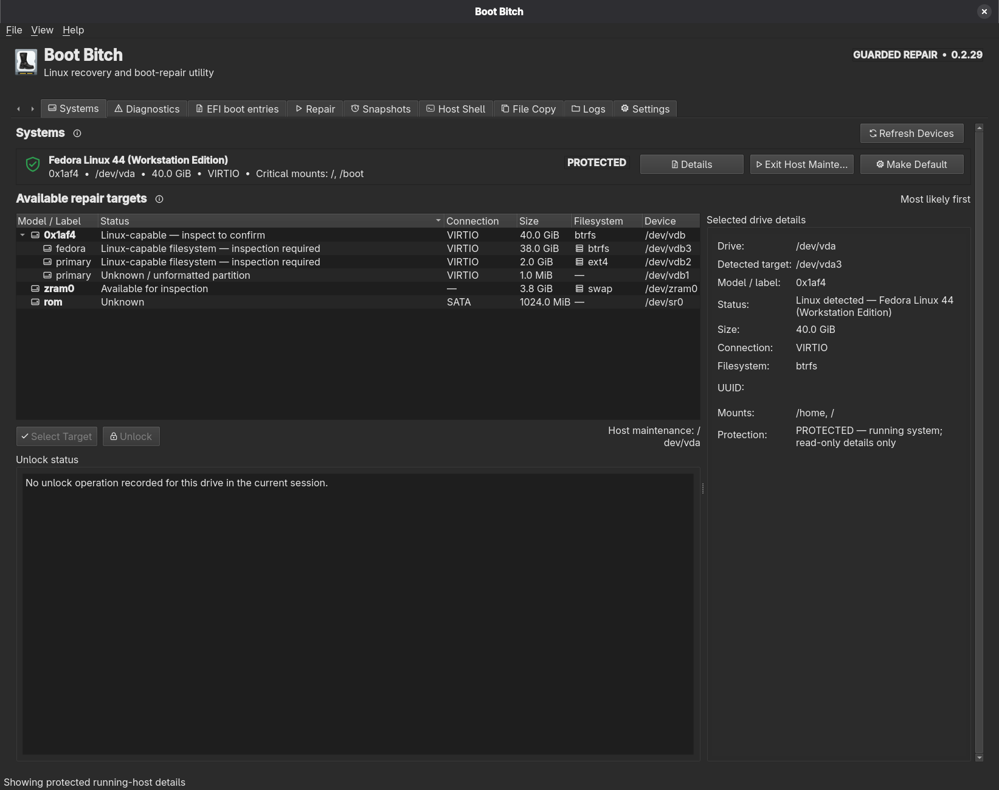
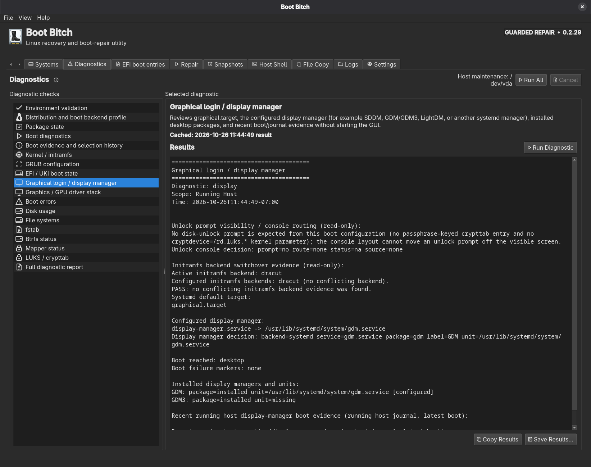
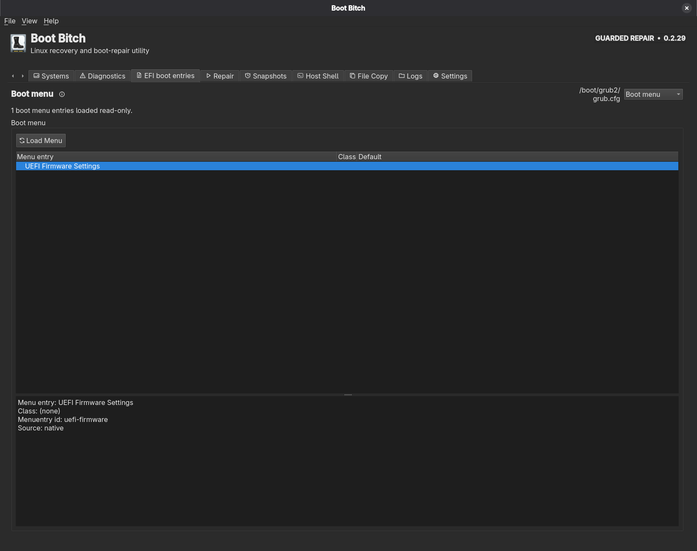
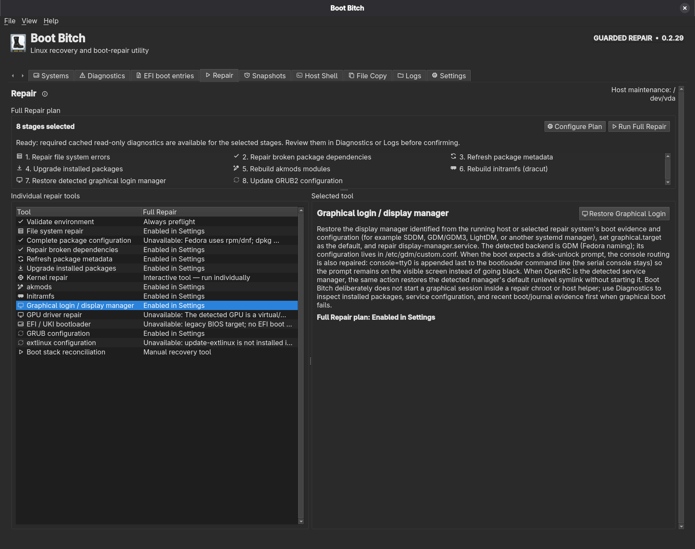
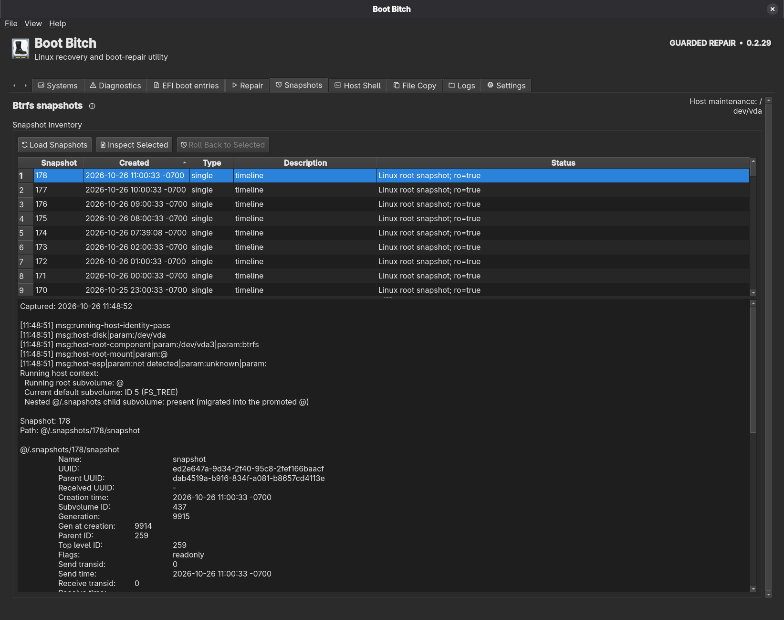
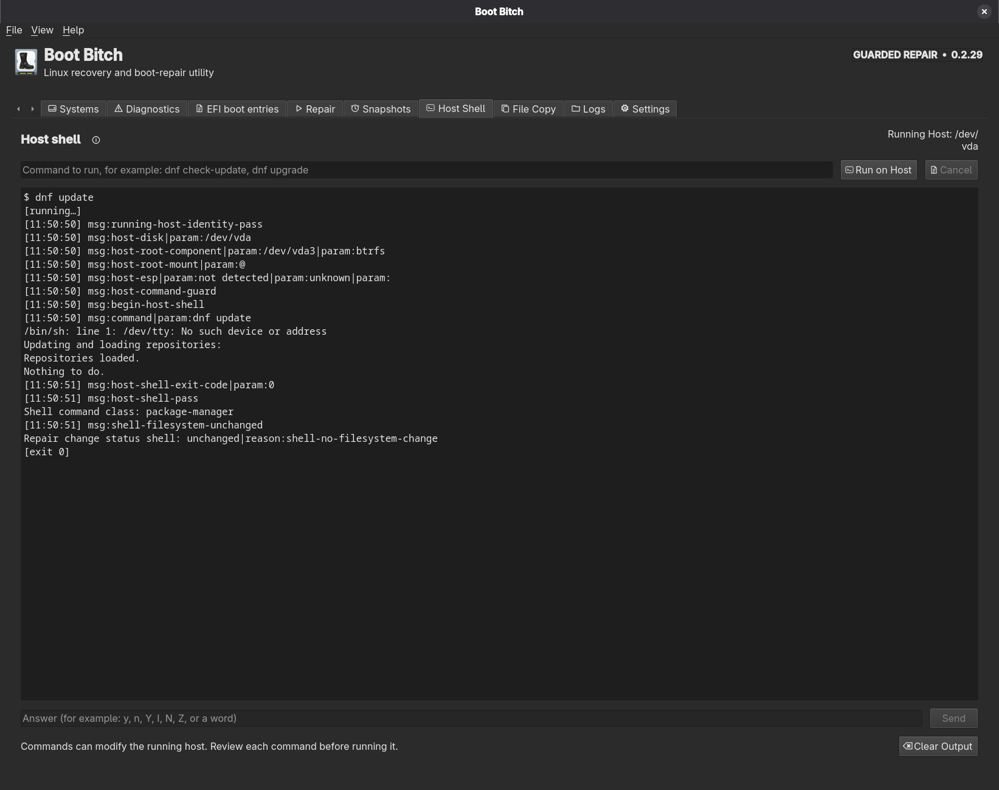
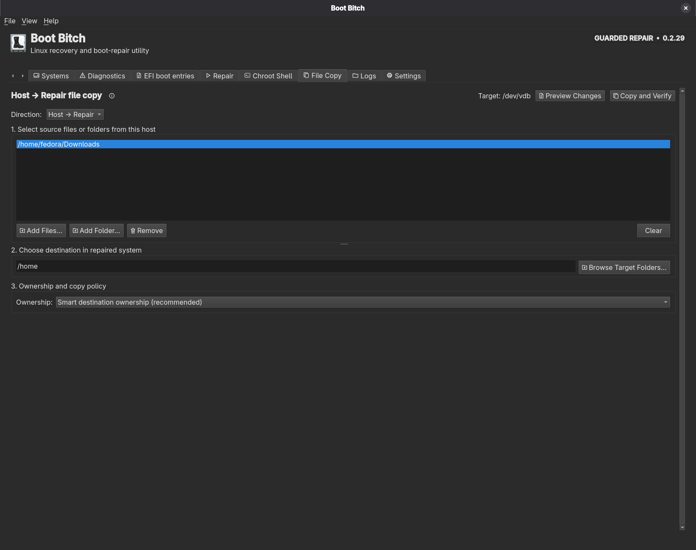
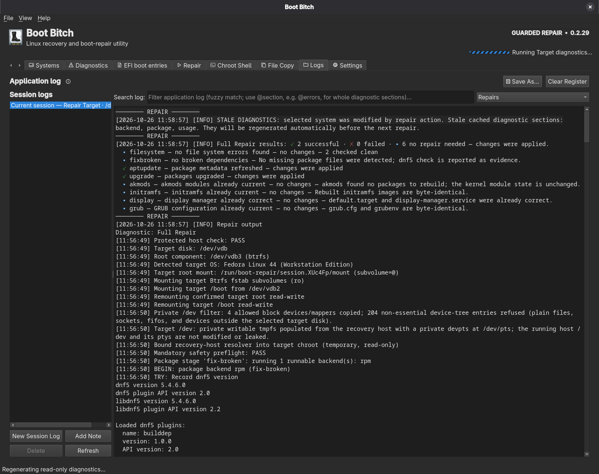
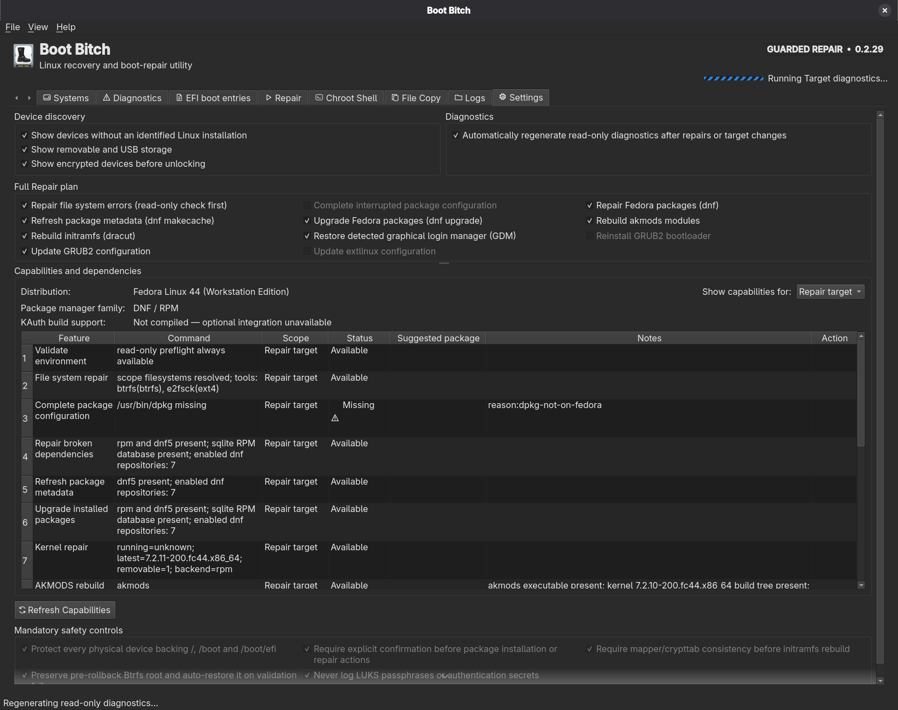

# Boot Bitch 0.2.32

Boot Bitch is a native Qt 6 Linux recovery utility. You select the running host or a repairable target Linux system, and the tool detects it, collects boot-relevant diagnostics (booting, reaching the graphical login, and keyboard and network availability at login) and edits selected target-system files directly; repairs that stack, including the interactive kernel, graphics-driver, graphical-login, input-device and network repairs, and builds the graphical/input/network modules into the kernel so they are available early in boot without kernel auto-detection; manages Btrfs snapshots (view, select, create, delete, and safely roll back to a prior functioning state); copies files between host and target; and runs chroot/shell commands for deeper problems. Each repair layer performs the strongest practical read-only or trial preflight available, applies only recognized deterministic corrections, and stops on unknown failures instead of guessing. The application was written to address the lack of coherent tooling that lets a non-developer restore a system so it can boot after something goes wrong. Common boot issues can be addressed directly, while the diagnostics, chroot shell and file-copy tools cover deeper problems.

This project was written with LLM assistance under human guidance, requirements and manually verified tests.

**Developer:** CaptainMorgan12

## Supported systems

Boot Bitch must be launched from a **different booted Linux environment for ordinary repair-target work**: a Linux live USB, recovery stick, or another Linux installation on a different physical drive. The running host can also be selected explicitly as a guarded Host Maintenance target. The GUI needs a Qt 6.4+ desktop (the Debian Etch legacy edition runs on Etch's Qt 3 desktop). Repair backends are selected from read-only probe evidence, never from the distribution name:

- **Debian / Ubuntu / TUXEDO and derivatives** — APT/dpkg package repair, initramfs-tools, DKMS, GRUB, TUXEDO UKI and EFI/UKI recovery.
- **Arch-family** — sandboxed pacman transactions, mkinitcpio, conventional GRUB/EFI and systemd-boot/UKI layouts.
- **Fedora / RHEL and openSUSE / SUSE** (0.2.25) — guarded DNF5/RPM package transactions, dracut initramfs with `lsinitrd` verification, GRUB2 configuration and boot-code repair, and the systemd GDM display path.
- **Alpine** (0.2.25) — `apk fix`/`apk upgrade` transactions, mkinitfs initramfs, config-only extlinux regeneration, OpenRC display-manager restore and guarded UEFI GRUB repair.
- **Debian Etch (legacy)** (0.2.26) — the Qt 3 / KDE 3.5 edition with the same privileged helper: LUKS unlock, split-LVM targets, guarded menu.lst regeneration, file copy, host maintenance and Make Default.

Host Maintenance runs the supported stages natively on the active Debian/Ubuntu, Fedora, Arch, Alpine or Debian Etch (legacy) system. Host EFI/UKI repair remains Debian/Arch-only (Alpine EFI adds guarded GRUB EFI repair), and unknown boot layouts are refused instead of guessed.

## Install

Download the artifact for your system from the GitHub release page and verify it against the attached `SHA256SUMS`:

| System | Artifact | Install |
| --- | --- | --- |
| Debian/Ubuntu/TUXEDO | `boot-bitch_0.2.31_amd64.deb` | `sudo apt install ./boot-bitch_0.2.31_amd64.deb` |
| Debian Etch (legacy, Qt 3) | `boot-bitch-legacy_0.2.31-etch1_amd64.deb` | `sudo dpkg -i ./boot-bitch-legacy_0.2.31-etch1_amd64.deb` |
| Arch | `boot-bitch-0.2.31-x86_64.pkg.tar.zst` | `sudo pacman -U boot-bitch-0.2.31-x86_64.pkg.tar.zst` |
| Fedora/RHEL | `boot-bitch-0.2.31.x86_64.rpm` | `sudo dnf install ./boot-bitch-0.2.31.x86_64.rpm` |
| openSUSE/SUSE | `boot-bitch-0.2.31.x86_64.rpm` | `sudo zypper install ./boot-bitch-0.2.31.x86_64.rpm` |
| Alpine | `boot-bitch-0.2.31.apk` | `sudo apk add --allow-untrusted ./boot-bitch-0.2.31.apk` |
| Any Linux desktop | `boot-bitch_0.2.31_x86_64.AppImage` | `chmod +x boot-bitch_0.2.31_x86_64.AppImage && ./boot-bitch_0.2.31_x86_64.AppImage` |

The native packages install the GUI, bundled icons, desktop metadata, the manual page, the EFI label helper and the privileged helper at `/usr/libexec/boot-bitch/boot-bitch-helper`. Privileged actions are authorized through Polkit/`pkexec` and use the host's runtime tools (`mount`, `cryptsetup`, `btrfs`, `efibootmgr`, and the selected distribution's boot and package tools); install the tools needed for the repair you intend to run.

Verify your download with `sha256sum -c SHA256SUMS` in the directory containing the downloaded artifact and the `SHA256SUMS` file from the same release.

Launch the installed command as `boot-bitch`. On GNOME, install the optional `qt6-gtk-platformtheme` and `qt6-xdgdesktopportal-platformtheme` packages for GTK-like controls and native file dialogs; KDE uses its normal Qt platform theme. The AppImage uses the same privilege boundary and is intended for portable use, not as a replacement for the native package; its file dialogs use Qt's own implementation, while installed builds keep their desktop's native dialogs.

`./scripts/install.sh` detects the host package family and installs a locally built `.deb`, RPM, Arch package or APK after an explicit `INSTALL` confirmation. `./scripts/install.sh --source` installs a staged CMake build under `/usr/local` (or another absolute `PREFIX`), and `./scripts/uninstall.sh` removes a detected native package or the source install after an explicit `UNINSTALL` confirmation.

## Build from source

### Dependencies

Required:

- C++17 compiler (GCC or Clang)
- CMake 3.20+
- Ninja
- Qt 6.4+ Core/Gui/Widgets development files

Runtime support used by the guarded repairs:

- Polkit / `pkexec`; util-linux (`lsblk`, `findmnt`, `blkid`, mount tools)
- `rsync` and `cryptsetup` for verified file copy and LUKS unlock
- systemd `systemctl` for graphical-target and display-manager repair
- `efibootmgr` for guarded UEFI entry/order inspection
- binutils `objcopy` for TUXEDO UKI verification; Python 3 for guarded EFI label updates
- file system check tools (for example `e2fsprogs`, `dosfstools`, `btrfs-progs`, `xfsprogs`) for the read-only-first file system repair engine

`./scripts/setup-dev-deps.sh` installs the build/runtime set for the detected package manager (APT/dpkg, pacman, DNF/RPM, zypper/RPM or apk), and `./scripts/check-dev-env.sh` inspects the environment without installing anything. The Debian/Ubuntu/TUXEDO command is:

```bash
sudo apt update && sudo apt install --no-install-recommends -y \
    build-essential cmake ninja-build pkg-config \
    qt6-base-dev qt6-base-dev-tools extra-cmake-modules \
    pkexec util-linux mount rsync cryptsetup btrfs-progs systemd \
    efibootmgr binutils python3 lvm2 mdadm
```

### Building

The standard manual build for your own system:

```bash
cmake -S . -B build -G Ninja -DCMAKE_BUILD_TYPE=Release
cmake --build build -j"$(nproc)"
./build/boot-bitch
```

A source install uses `-DCMAKE_INSTALL_PREFIX=/usr/local` (or another prefix) followed by `sudo cmake --install build`.

`./scripts/build.sh` does the Release build plus the Debian-family `.deb` (on Debian-family hosts) and the AppImage (when linuxdeploy/appimagetool are available); on OTHER distributions run the ONE package script that matches your system — `package-arch.sh` (Arch), `package-rpm.sh` (Fedora/RHEL), `package-alpine.sh` (Alpine) — each building a single native package without installing it, using the distribution's own packaging tools (dpkg-dev, rpmbuild, makepkg, abuild). Nothing is installed unless you run `install.sh`.

### Upgrading an existing source build

An existing source checkout upgrades between releases with the source-change patch attached to the new release (`source-changes-since-<previous>.patch`): download it from the GitHub release page, apply it from the source root (`git apply source-changes-since-0.2.30.patch`, or `patch -p1 < source-changes-since-0.2.30.patch` outside Git), then install the build dependencies (`./scripts/setup-dev-deps.sh`), rebuild and install as above — the CMake/Ninja release build followed by `sudo cmake --install build`, or `./scripts/build.sh` with the matching `install.sh`.

## Safety model

- Boot Bitch runs as the normal desktop user. Privileged work is isolated in a whitelisted helper behind Polkit/`pkexec`; one authorization per scope is reused until the session is locked or the application exits.
- Ordinary repair-target actions refuse the running host. The top-level devices backing `/`, `/boot` and `/boot/efi` stay protected, and Host Maintenance must be selected explicitly, repeating host identity and mount checks.
- Every repair layer runs the strongest practical read-only or simulation preflight first and applies only recognized deterministic corrections; unknown failures stop the stage instead of guessing.
- Every modifying operation requires an explicit GUI confirmation, and diagnostics are cached per scope and invalidated by writes.
- LUKS passphrases are sent to the helper over standard input only, never in command arguments or logs.
- File copy uses `rsync -aHAX --numeric-ids` without `--delete`, validates containment and ownership, and verifies the result.
- Btrfs rollback keeps the source snapshot unchanged, preserves the previous root as `@rollback-before-*`, and restores it automatically when critical post-switch validation fails.
- Missing optional runtime tools disable only the related feature; host tools are never installed silently.
- The AppImage self-update channel is transport-authenticated over HTTPS but not content-signed; verify the release `SHA256SUMS` before applying a fetched update.

Still intentionally constrained in 0.2.32:

- automatic/implicit EFI-loader reinstall: EFI repair remains an explicit action or opt-in Full Repair stage;
- transactional rollback is limited to Btrfs layouts whose installed root is a detectable top-level root subvolume (`@` or the name-agnostic detection) with Snapper-style root snapshots; single, pre and post snapshots are accepted rollback targets. Running-host rollback additionally requires a Snapper root configuration, no `subvolid=` pin and no other nested `@` child subvolumes, supports a separate `/boot` through a bounded file-level capture (refused only when the capture is infeasible), and only migrates a nested `@/.snapshots` child subvolume; unsupported layouts are refused rather than guessed. The running-host rollback keeps `/home` retained by design, while the repair-target rollback asks whether the separate `/home` subvolume rolls back together with the root (the opt-in full restore); the snapshot list survives a successful rollback, the preserved undo points resolve by name alongside numeric ids and appear in the list, and the staged rollback's source snapshot cannot be deleted. The manual Create Snapshot action requires the same Snapper root configuration and `.snapshots` store;
- unsupported package-manager operations on Arch (such as standalone APT/dpkg stages), unknown boot layouts, and package transactions whose preflight reports repository errors, removals or unresolved dependencies; these remain hard-gated. User-supplied local-package installs are supported on every package family through the guarded local-file verb (`pacman -U` on Arch, `apk add <file>` on Alpine, and the dpkg/apt and rpm/dnf5 equivalents).

## Using Boot Bitch

- **Systems** — shows the protected running host separately from ranked repair drives; select a physical target (and unlock LUKS when needed) before any repair work.
- **Diagnostics** — read-only reports for the Running Host or the selected repair drive, including boot state, firmware entries and file systems.
- **EFI boot entries** — the UEFI firmware entry list with reorder, rename and delete (BootCurrent is protected, NVRAM writes are verified and rolled back), plus a read-only boot-menu tree.
- **Repair** — the configurable Full Repair plan and individual tools (file system repair, package configuration, broken dependencies, metadata refresh, adaptive package upgrade, DKMS, display manager, initramfs, EFI/UKI and GRUB), or Host Maintenance on the active system.
- **Snapshots** — read-only Btrfs/Snapper inventory with an All/Single/Pre/Post filter, a guarded manual **Create Snapshot** action, and the transactional rollback workflow (single, pre and post targets), including running-host rollback with a persistent **Reboot required** reminder.
- **Chroot Shell** — one confirmed root command at a time inside the selected repair system. When a command asks a question (apt/dnf/dpkg prompts), it appears in a popup and your answer is sent back to the command; cancel stops it. Non-interactive flags such as `-y`/`--noconfirm` remain recommended for unattended runs.
- **File Copy** — guarded Host → Repair and Repair → Host transfers with preview and verification; repair-to-host copies remove setuid/setgid bits and file capabilities and refuse shared scratch (sticky or world-writable) destination directories.
- **Logs / Settings** — per-session logs with section filters, and the repair plan, safety rules and capability report.

## Screenshots

These anonymized screenshots show Boot Bitch running in a disposable recovery VM. The target is a separate virtual disk; personal host paths and physical-device identifiers have been removed. The captures were refreshed for this release — nine screenshots (`1.png`..`9.png`) in the order below.

### Systems



### Diagnostics



### EFI boot entries



### Repair



### Snapshots



### Host Shell



### File Copy



### Logs



### Settings



## 0.2.32 refinements

The changes in this release are listed below. See the [0.2.32 release notes](docs/release-notes-0.2.32.md).

- Display manager: the graphical-login repair is a walk-through preferring the last successful login, then the in-use manager, then the vendor default; the greetd landing installs the greeter and writes the post-login session command for the detected desktop shell, or refuses where none exists, and after a restore-default the active manager stays current, hence not a switch candidate, until the reboot completes the staged transition.
- Kernel repair: the module-versus-kernel incompatibility evidence distinguishes genuine build failures (the module's own build log and its declared highest compatible kernel version) from half-configured state blockers; per-kernel remedies install the prior compatible kernel with a next-boot switch or update the vendor module package, and the module repair only points at these actions.
- Kernel removal: removing a kernel completes forcefully — packages, module tree, headers, pinned-only metapackages and DKMS entries all go with it, the surviving kernel's state stays intact, and the removal plan plus its safety validator derive from the then-current package state so a mid-session headers install is never refused as protected.
- Boot menu: the boot-entries view gains Move Up, Move Down and Save buttons that commit the reorder through a verified grub-reorder step into a persisted order file which survives the tool's own GRUB regeneration, plus a Current default indicator reconciled through the guarded saved-entry write.
- Num Lock: the early-boot Num Lock repair is now complete across every family — the Fedora getty drop-in fallback chain, the automatic propagation-drop detection and promotion, the Alpine OpenRC invocation fix, the mkinitcpio hook drop-in and the host payload self-placement — with the diagnostic reporting the console state and the revert restoring it.
- Fixes: the Arch kernel pairing false negative (a present flavour-named initramfs was reported missing), the display-manager switch refusal re-displays the candidate menu instead of failing the stage, the leftover %1 placeholder in the kernel downgrade confirmation, the busybox-awk stream-filter portability on Alpine, the GDM/GDM3 alias duplication, the cancel output leak in the transcript and the volatile-NVRAM EFI entry verdict with its durability note.

## Earlier releases

The per-version change summaries for 0.2.30 and earlier are recorded in [CHANGELOG.md](CHANGELOG.md) and in each GitHub release's own notes. Versions before 0.2.15 were development iterations that were not published as GitHub releases.


## License

Boot Bitch is released under the MIT License. See `LICENSE`.

Boot Bitch comes with ABSOLUTELY NO WARRANTY, to the extent permitted by applicable law.


