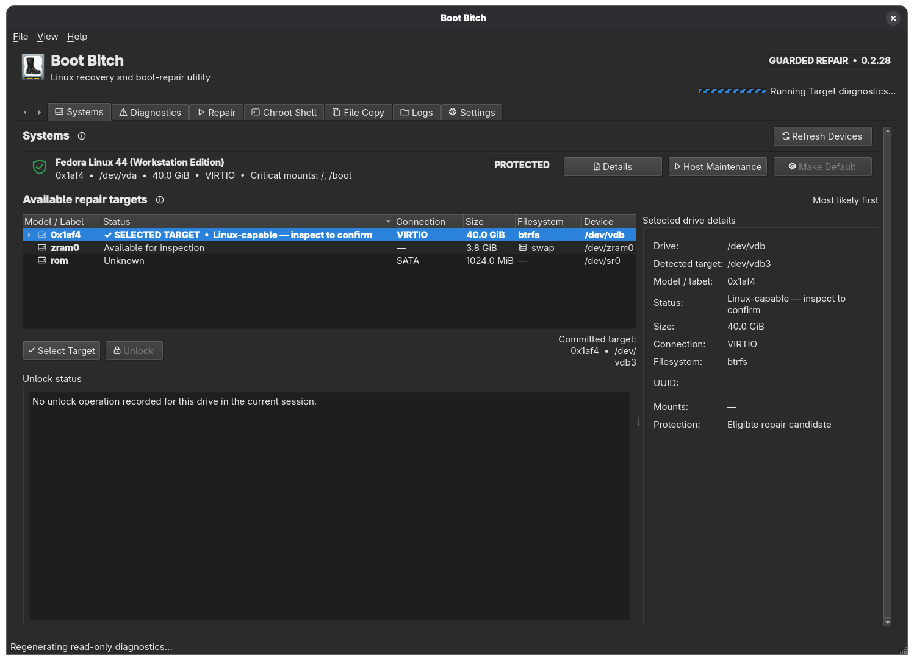
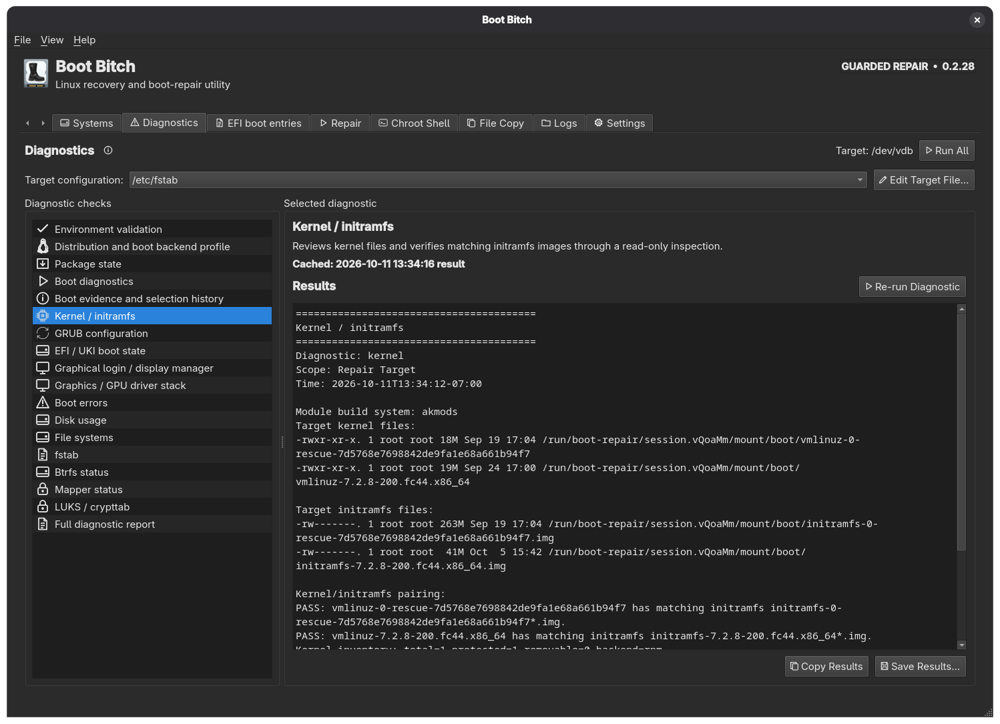
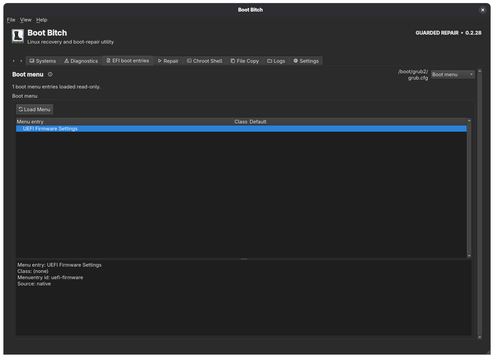
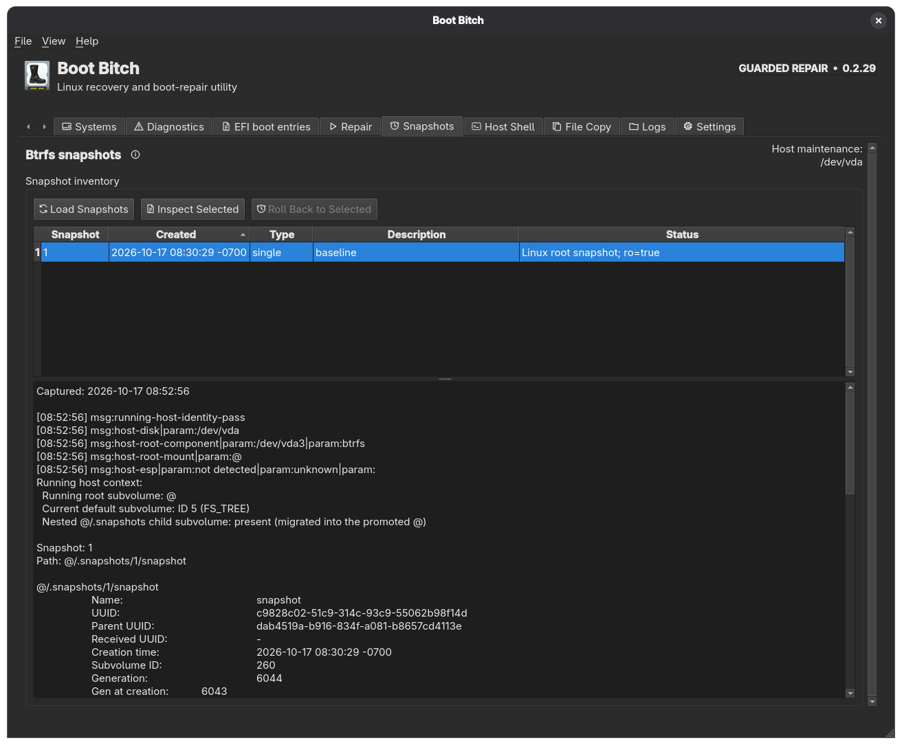
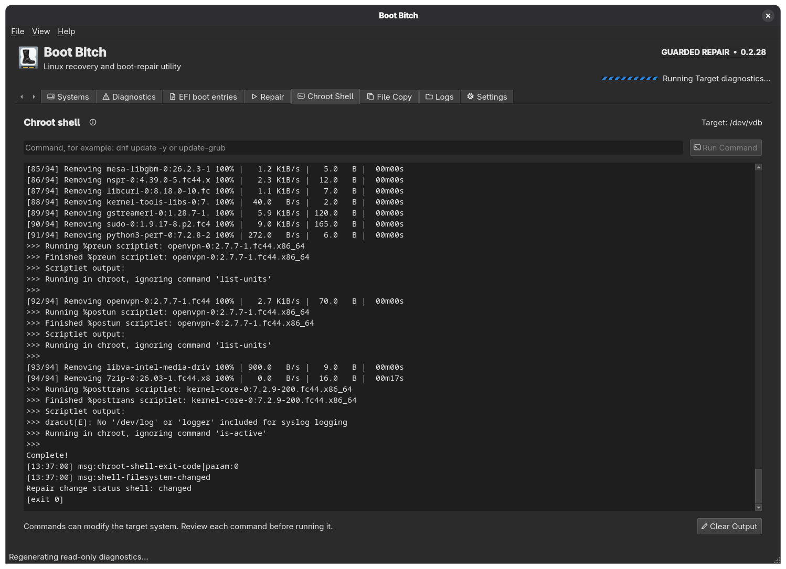
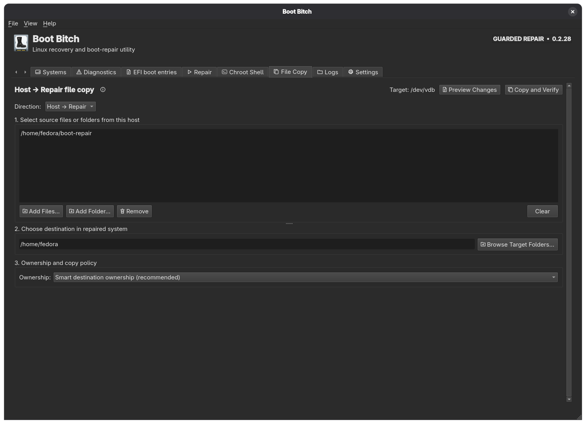
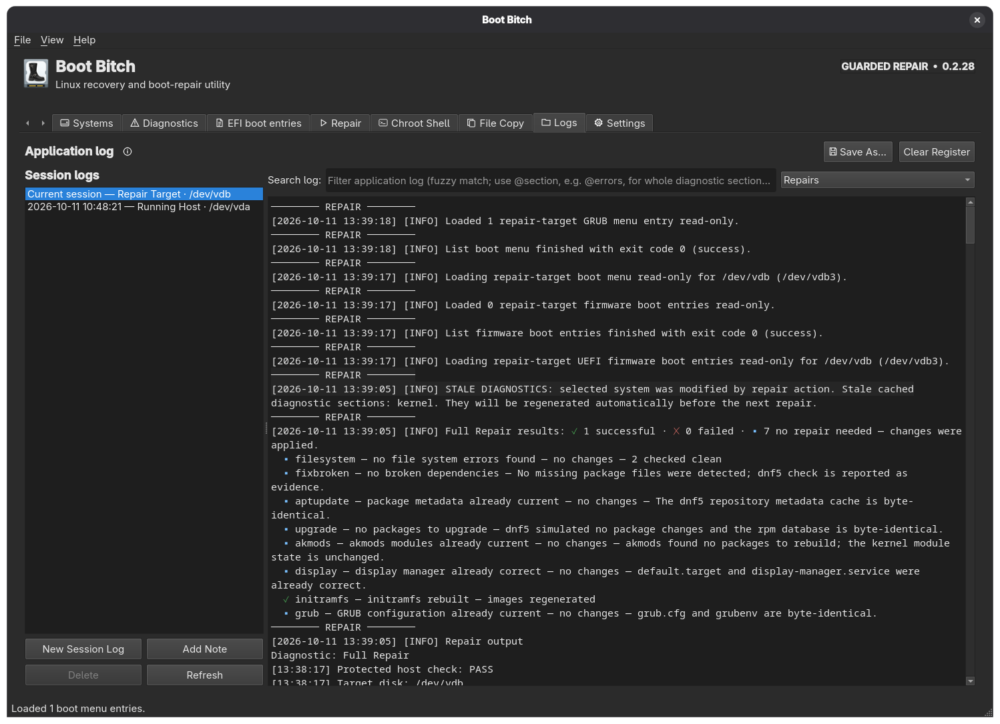
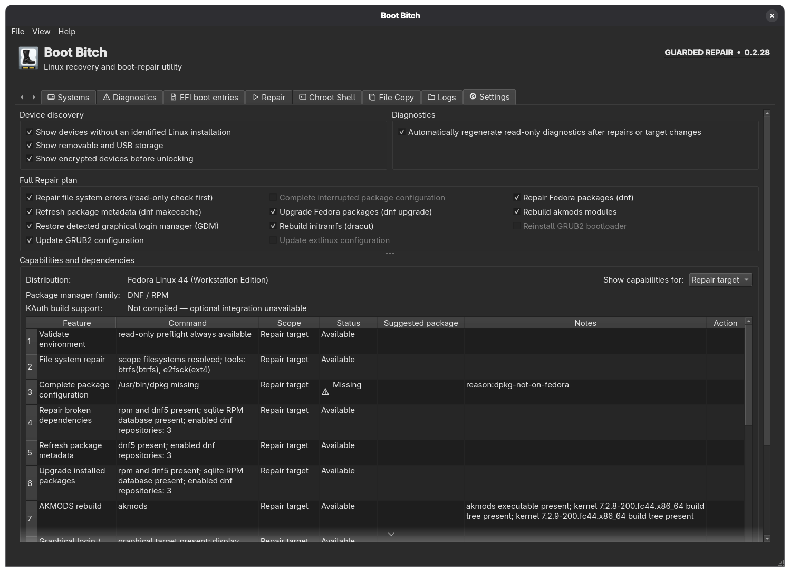

# Boot Bitch 0.2.26 — maintenance release

Boot Bitch is a native Qt 6 Linux recovery utility. The application command and Debian package retain the stable technical name `boot-repair` for compatibility; the source repository is `Boot_Bitch`. Version 0.2.26 includes the guarded diagnostics cache, simulation-first repair stack, Btrfs snapshot recovery, audited chroot shell, verified file copy, responsive Qt interface, and native RPM/APK artifacts with Alpine, Arch and Fedora repair backends. Each repair layer performs the strongest practical read-only or trial preflight available, applies only recognized deterministic corrections, and stops on unknown failures instead of guessing. The application was written to address the lack of coherent tooling that lets a non-developer restore a system so it can boot after something goes wrong. Common boot issues can be addressed directly, while the diagnostics, chroot shell and file-copy workflows also support troubleshooting and manual fixes.

This project was written with LLM assistance under human guidance, requirements and manually verified tests.

**Developer:** CaptainMorgan12

## Supported systems

Boot Bitch must be launched from a **different booted Linux environment for ordinary repair-target work**: a Linux live USB, recovery stick, or another Linux installation on a different physical drive. The running host can also be selected explicitly as a guarded Host Maintenance target. The GUI needs a Qt 6.4+ desktop. Repair backends are selected from read-only probe evidence, never from the distribution name:

- **Debian / Ubuntu / TUXEDO and derivatives** — APT/dpkg package repair, initramfs-tools, DKMS, GRUB, TUXEDO UKI and EFI/UKI recovery.
- **Arch-family** — sandboxed pacman transactions, mkinitcpio, conventional GRUB/EFI and systemd-boot/UKI layouts.
- **Fedora / RHEL and openSUSE / SUSE** (0.2.25) — guarded DNF5/RPM package transactions, dracut initramfs with `lsinitrd` verification, GRUB2 configuration and boot-code repair, and the systemd GDM display path.
- **Alpine** (0.2.25) — `apk fix`/`apk upgrade` transactions, mkinitfs initramfs, config-only extlinux regeneration, OpenRC display-manager restore and guarded UEFI GRUB repair.

Host Maintenance runs the supported stages natively on the active Debian/Ubuntu, Arch or Alpine system. EFI/UKI stages remain Debian/Arch-only, and unknown boot layouts are refused instead of guessed.

## Install

Download the artifact for your system from the GitHub release page and verify it against the attached `SHA256SUMS`:

| System | Artifact | Install |
| --- | --- | --- |
| Debian/Ubuntu/TUXEDO | `boot-repair_0.2.25_amd64.deb` | `sudo apt install ./boot-repair_0.2.25_amd64.deb` |
| Arch | `boot-bitch-0.2.25-x86_64.pkg.tar.zst` | `sudo pacman -U boot-bitch-0.2.25-x86_64.pkg.tar.zst` |
| Fedora/RHEL | `boot-bitch-0.2.25.x86_64.rpm` | `sudo dnf install ./boot-bitch-0.2.25.x86_64.rpm` |
| openSUSE/SUSE | `boot-bitch-0.2.25.x86_64.rpm` | `sudo zypper install ./boot-bitch-0.2.25.x86_64.rpm` |
| Alpine | `boot-bitch-0.2.25.apk` | `sudo apk add --allow-untrusted ./boot-bitch-0.2.25.apk` |
| Any Linux desktop | `boot-repair_0.2.25_x86_64.AppImage` | `chmod +x boot-repair_0.2.25_x86_64.AppImage && ./boot-repair_0.2.25_x86_64.AppImage` |

The native packages install the GUI, bundled icons, desktop metadata, the manual page, the EFI label helper and the privileged helper at `/usr/libexec/boot-repair/boot-repair-helper`. Privileged actions are authorized through Polkit/`pkexec` and use the host's runtime tools (`mount`, `cryptsetup`, `btrfs`, `efibootmgr`, and the selected distribution's boot and package tools); install the tools needed for the repair you intend to run.

Launch the installed command as `boot-repair`. On GNOME, install the optional `qt6-gtk-platformtheme` and `qt6-xdgdesktopportal-platformtheme` packages for GTK-like controls and native file dialogs; KDE uses its normal Qt platform theme. The AppImage uses the same privilege boundary and is intended for portable use, not as a replacement for the native package; it bundles the SVG icon engine and the desktop integration (Qt platform themes and widget styles) present on its build host, so the release AppImage is built on a Debian-family desktop (see [Build packages](#build-packages)). File dialogs inside the AppImage use Qt's own implementation because the KIO/GTK worker and portal services the native dialogs rely on are not bundled; installed builds keep their desktop's native dialogs.

`./scripts/install.sh` detects the host package family and installs a locally built `.deb`, RPM, Arch package or APK after an explicit `INSTALL` confirmation. `./scripts/install.sh --source` installs a staged CMake build under `/usr/local` (or another absolute `PREFIX`), and `./scripts/uninstall.sh` removes a detected native package or the source install after an explicit `UNINSTALL` confirmation.

## Build from source

### Dependencies

Required:

- C++17 compiler (GCC or Clang)
- CMake 3.20+
- Ninja
- Qt 6.4+ Core/Gui/Widgets development files (the CI suite builds against Ubuntu's Qt 6.4)

Runtime and packaging support used by guarded repair builds:

- Polkit / `pkexec`; util-linux (`lsblk`, `findmnt`, `blkid`, mount tools)
- `rsync` and `cryptsetup` for verified file copy and LUKS unlock
- systemd `systemctl` for graphical-target and display-manager repair
- `efibootmgr` for guarded UEFI entry/order inspection
- binutils `objcopy` for TUXEDO UKI verification; Python 3 for guarded EFI label updates
- file system check tools (for example `e2fsprogs`, `dosfstools`, `btrfs-progs`, `xfsprogs`) for the read-only-first file system repair engine
- Debian packaging tools for `.deb`, `rpmbuild` for RPM, `makepkg` for Arch, `abuild` for APK, and CPack's TGZ generator for the package-manager-neutral archive
- KDE Frameworks 6 KAuth development files remain optional

`./scripts/setup-dev-deps.sh` installs the build/runtime set for the detected package manager (APT/dpkg, pacman, DNF/RPM, zypper/RPM or apk), and `./scripts/check-dev-env.sh` inspects the environment without installing anything. The Debian/Ubuntu/TUXEDO command is:

```bash
sudo apt update && sudo apt install --no-install-recommends -y \
    build-essential cmake ninja-build pkg-config \
    qt6-base-dev qt6-base-dev-tools extra-cmake-modules \
    dpkg-dev desktop-file-utils lintian \
    pkexec util-linux mount rsync cryptsetup btrfs-progs systemd \
    efibootmgr binutils python3 lvm2 mdadm
```

### One-command Release build

```bash
./scripts/build.sh
```

This performs a clean Release build, validates an isolated staged install and writes the artifacts under `build-release/`. On Debian-family build hosts it also creates the `.deb`; when `linuxdeploy`/`appimagetool` are available it creates the versioned AppImage with its `.zsync` update metadata, so Gear Lever/AppImageUpdate can detect new GitHub releases. Nothing is installed.

```bash
./build-release/boot-repair                   # run the build directly
./scripts/test-deb.sh build-release/*.deb     # validate without installing
```

### Manual build

```bash
cmake -S . -B build -G Ninja -DCMAKE_BUILD_TYPE=Release
cmake --build build -j"$(nproc)"
./build/boot-repair
```

A standard source install uses `-DCMAKE_INSTALL_PREFIX=/usr/local` (or another prefix) followed by `sudo cmake --install build`. KF6Auth is discovered directly with `find_package(KF6Auth QUIET NO_MODULE)`, so distributions do not need an umbrella `KF6Config.cmake`.

### Build packages

Each packaging script stages a Release build and creates the artifact without installing it; the generated path is printed and can be redirected with `BUILD_DIR`:

```bash
./scripts/package-deb.sh       # Debian package
./scripts/package-arch.sh      # native Arch package (makepkg)
./scripts/package-rpm.sh       # RPM (CPack/rpmbuild)
./scripts/package-alpine.sh    # signed APK (abuild, Alpine build user)
./scripts/package-tarball.sh   # package-manager-neutral TGZ
./scripts/build-appimage.sh    # AppImage + .zsync under build-release/
```

Build the release AppImage on a Debian-family desktop (the reference host is
TUXEDO OS) with `qt6-svg-plugins`, `plasma-integration`,
`qt6-gtk-platformtheme` and `qgnomeplatform-qt6` installed: `linuxdeploy` can
only bundle the Qt SVG icon engine and the platform themes/widget styles the
build host provides, so widget styling matches the desktop only when the
AppImage is built there. File dialogs stay Qt's own inside the AppImage (the
native dialogs need worker/portal services the image does not carry) while
installed builds keep the desktop's native dialogs. `scripts/build-appimage.sh`
and `scripts/build.sh` print a non-fatal warning on other hosts and when no
platform theme was bundled, and `DEPLOY_PLATFORM_THEMES=0` opts out of theme
bundling.

The AppImage build probes the payload for the `.relr.dyn` relocations current
distributions emit and picks safe fallbacks automatically: a system `patchelf`
0.18 or newer when available, no stripping when the bundled strip cannot read
the section, and self-extracting AppImage mode when FUSE is unavailable. This
lets Arch, Fedora, Alpine and current Debian-family hosts build a working
AppImage; the build stops with installation instructions only when no
RELR-capable `patchelf` exists. `PATCHELF`, `NO_STRIP` and
`APPIMAGE_EXTRACT_AND_RUN` override the detection.

The AppImage's zsync self-update channel (what Gear Lever/AppImageUpdate read
through the embedded `gh-releases-zsync` update information) is
transport-authenticated over HTTPS but not content-signed: the `.zsync`
metadata carries zsync's SHA-1 block checksums, which verify that the update
client received the bytes the server served, not who authored them. Gating
AppImage self-updates behind a signed checksum (for example verifying the
release `SHA256SUMS` before applying a fetched update) is future work.

Validate generated packages without installing them:

```bash
./scripts/test-deb.sh
./scripts/test-rpm.sh
./scripts/test-apk.sh
```

## Testing

Configure a Release build and run the test suite:

```bash
cmake -S . -B build -G Ninja -DCMAKE_BUILD_TYPE=Release
cmake --build build -j"$(nproc)"
QT_QPA_PLATFORM=offscreen ctest --test-dir build --output-on-failure
```

The tests cover the MainWindow workflow plus the chroot-shell, display-manager, filesystem-repair, host-snapshot, icon-atlas, backend-profile and EFI-label contracts; `ctest -L fast` runs the quick tier. CI additionally runs `bash -n scripts/*.sh` and `appstreamcli validate --no-net` on the AppStream metadata. The package validation scripts (`test-deb.sh`, `test-rpm.sh`, `test-apk.sh`) inspect metadata, dependencies and the installed file set of a built artifact without installing it.

## Safety model

- Boot Bitch runs as the normal desktop user. Privileged work is isolated in a whitelisted helper behind Polkit/`pkexec`; one authorization per scope is reused until the session is locked or the application exits.
- Ordinary repair-target actions refuse the running host. The top-level devices backing `/`, `/boot` and `/boot/efi` stay protected, and Host Maintenance must be selected explicitly, repeating host identity and mount checks.
- Every repair layer runs the strongest practical read-only or simulation preflight first and applies only recognized deterministic corrections; unknown failures stop the stage instead of guessing.
- Every modifying operation requires an explicit GUI confirmation, and diagnostics are cached per scope and invalidated by writes.
- LUKS passphrases are sent to the helper over standard input only, never in command arguments or logs.
- File copy uses `rsync -aHAX --numeric-ids` without `--delete`, validates containment and ownership, and verifies the result.
- Btrfs rollback keeps the source snapshot unchanged, preserves the previous root as `@rollback-before-*`, and restores it automatically when critical post-switch validation fails.
- Missing optional runtime tools disable only the related feature; host tools are never installed silently.

Still intentionally constrained in 0.2.26:

- automatic/implicit EFI-loader reinstall: EFI repair remains an explicit action or opt-in Full Repair stage;
- transactional rollback is limited to Btrfs layouts with a normal top-level `@` root and Snapper-style root snapshots; running-host rollback additionally requires a Snapper root configuration, no `subvolid=` pin, no separate `/boot` and no other nested `@` child subvolumes, and only migrates a nested `@/.snapshots` child subvolume; unsupported layouts are refused rather than guessed;
- unsupported package-manager operations on Arch (such as standalone APT/dpkg stages), unknown boot layouts, and package transactions whose preflight reports repository errors, removals or unresolved dependencies; these remain hard-gated.

## Using Boot Bitch

- **Systems** — shows the protected running host separately from ranked repair drives; select a physical target (and unlock LUKS when needed) before any repair work.
- **Diagnostics** — read-only reports for the Running Host or the selected repair drive, including boot state, firmware entries and file systems.
- **Repair** — the configurable Full Repair plan and individual tools (file system repair, package configuration, broken dependencies, metadata refresh, adaptive package upgrade, DKMS, display manager, initramfs, EFI/UKI and GRUB), or Host Maintenance on the active system.
- **Snapshots** — read-only Btrfs/Snapper inventory and the guarded rollback workflow, including running-host rollback with a persistent **Reboot required** reminder.
- **Chroot Shell** — one confirmed root command at a time inside the selected repair system. When a command asks a question (apt/dnf/dpkg prompts), it appears in a popup and your answer is sent back to the command; cancel stops it. Non-interactive flags such as `-y`/`--noconfirm` remain recommended for unattended runs.
- **File Copy** — guarded Host → Repair and Repair → Host transfers with preview and verification; repair-to-host copies remove setuid/setgid bits and file capabilities and refuse shared scratch (sticky or world-writable) destination directories.
- **Logs / Settings** — per-session logs with section filters, and the repair plan, safety rules and capability report.

## Screenshots

These anonymized screenshots show Boot Bitch running in a disposable recovery VM. The target is a separate virtual disk; personal host paths and physical-device identifiers have been removed.

### Systems



### Diagnostics



### Repair



### Snapshots



### Chroot Shell



### File Copy



### Logs



### Settings



## 0.2.26 refinements

0.2.26 delivers the fully functional Debian Etch (Qt 3 / KDE 3.5) edition and the security-hardening release: every surface of the privileged backend, both GUIs, the legacy port generator and the packaging tooling was audited and hardened, and the interactive shell-prompt answering plus the accumulated legacy parity work ship with it. See the [0.2.26 release notes](docs/release-notes-0.2.26.md).

- Security sweep: a full multi-agent review of the modern helper, both GUIs,
  the legacy port generator and the packaging tooling produced a large
  hardening pass. Mount containment: target-controlled fstab mountpoints
  (btrfs subvolumes and data partitions) are lexically, realpath- and
  symlink-validated before mounting; the session-log append into the repaired
  system refuses symlinked target log paths; the resolver validates before
  creating; the pacman sandbox no longer resolves through a target /tmp
  symlink and cleanup never removes a host-absolute path; offline filesystem
  repair fails closed on busy mounts instead of lazy-detaching; fs scope
  resolution gates fstab devices to the selected disk; recovery mounts force
  nosuid,nodev and drop context=/seclabel; LUKS UUIDs are validated before
  mapper-name composition; EFI/bootloader apply stages re-assert the
  protected-host identity gate; and a per-target-disk lock refuses concurrent
  repair sessions on the same disk. Interactive shell and wire protocol: a
  per-pump random token gates PROMPT forwarding so a command cannot forge
  prompt dialogs; the shell deadline is evaluated on every pump iteration
  (continuously-streaming commands time out); the runner-death drain is
  bounded; the pty echo of answers is redacted so typed secrets never reach
  the wire, session log or transcript; a dead runner never produces a prompt;
  SIGPIPE can no longer kill the root session; CSI/OSC sequences are bounded;
  chroot-shell exit codes 124/125 propagate; apt retries are binary-aware (apt
  full-upgrade / apt-get dist-upgrade); shell command quoting is POSIX-safe;
  apt probing happens inside the target chroot; protocol records are
  length-capped; a session secret is only accepted for unlock. Process
  lifecycle: helper runs register in a root-owned PID registry and cleanup
  kills still-alive registered children before unmounting; the interactive
  pump group-kills the runner's whole tree; the broker dispatches under
  setsid; the host-shell timeout gains --kill-after; the GUI watchdog sends
  QUIT before terminating and pauses while a prompt popup is open. Repair
  chroots receive a filtered private /dev (essential nodes, dm control and
  devices on the selected target disk only). File Copy to the host strips
  setuid/setgid and drops security.capability (probed flags, suid-masked
  verification, fail-closed post-copy scan) and refuses sticky/world-writable
  destinations with TOCTOU re-validation before every transfer. GRUB
  regeneration runs with GRUB_DISABLE_OS_PROBER=true (a deliberate dual-boot
  behavior change; the native-entry preservation guard is unchanged). GUI
  hardening: helper resolution never uses the current directory and the
  environment override is test-only, portable helpers must be owner-matched
  and not group/world-writable; privileged arguments are validated per
  argument class; the capability gate reads only the dedicated capabilities
  entry (target-controlled file content can no longer forge gating lines); the
  root-component fallback requires the same disk and a non-protected
  component; password-shaped prompt answers are masked in the transcript while
  the raw answer still reaches the helper; session logs are 0600 and the log
  directory 0700; settings are 0600; one prompt dialog at a time with a
  bounded prompt budget; per-request transcript caps; scanner reads are
  bounded and device display strings are control-character-stripped;
  config-write content now travels through a guarded mode-600 secret file
  instead of process arguments (1 MiB cap, never logged, never deleted by the
  helper). Legacy edition: the port generator fails loudly on no-op transforms
  and completed its bash-4 blacklist; the unlock keyfile can no longer land at
  the filesystem root and requires provable ownership (the helper never
  deletes a caller-supplied file); sudo/gksu/gksudo resolve from fixed trusted
  paths only and the elevated helper is verified before running; cancel now
  carries a helper-side cancel token with bounded TERM/KILL escalation; the
  host shell is timeout-bounded; the config-write secret-file transport is
  ported; logs are 0600 with O_NOFOLLOW opens. Tooling: build scripts
  whitelist their rm -rf targets, the EFI label updater refuses symlinked
  backups and reports rollback failures honestly, the zsync update channel is
  documented as transport-only-authenticated, zsyncmake temp dirs are cleaned
  up, and the dev rig scripts scrub guest passwords from serial logs, validate
  and quote guest-shell interpolations and serialize release-artifact syncs.
- Cycle 16 (interactive shell): the Chroot Shell and Host Shell can now answer
  interactive prompts. The helper runs shell commands under a PTY (with a
  plain stdin-pipe fallback) and, whenever the command is alive but its output
  has been quiet, sends the trailing output to the GUI as a base64 `PROMPT`
  wire record — no prompt text is ever pattern-matched or interpreted. Boot
  Bitch shows a "Shell command is asking for input" popup with the output and
  a free-text answer field; the answer is written back to the command
  (repeatedly for multi-question commands such as debconf flows), while
  cancel, an empty answer, or no answer within the window fails the command
  closed with the non-interactive hint. The per-command timeout pauses while a
  prompt awaits the user. Non-interactive flags (`dnf update -y`, `apt-get -y
  upgrade`) remain recommended for unattended runs; the legacy Qt3 shell keeps
  its non-interactive behavior for now.
- Cycle 15 (modern parity): Select Target now mirrors the modern
  diskIsSelectableRepairTarget predicate — enabled for every selectable
  non-host, non-optical drive including blank/non-Linux data disks (a locked
  LUKS container without a visible Linux filesystem stays unlock-only), the
  committed drive keeps the button enabled with the committed tooltip, and a
  root-less commit stores the disk itself so diagnostics fail closed with the
  helper's reason; the protected running host is excluded from the candidate
  tree; the status-bar scope text is transient (timeout) plus the transient
  "Repair drive selected: …" commit message; the Repair plan buttons reflow to
  their own row and the tool title can shrink so "Reconcile Boot Stack" never
  clips at the minimum width; the (i) buttons hug their page titles; the
  drive-row details roll up the UUID (unlocked root > LUKS container > Linux
  root partition).
- Cycle 14 UI fixes: the (i) help affordance is now a frameless hyperlink
  label beside each page title that opens a width-constrained read-only info
  dialog on click (no tooltip-only behavior); the File Copy sections are
  restored inside the vertical splitter (the panes own the groups from
  construction); the PROTECTED and GUARDED REPAIR badges lose their frames;
  the protected-host details pane shows the root component's UUID and Mounts;
  the session unlock state survives rescans while the mapping exists (leaving
  Host Maintenance no longer loses the unlocked target) and the helper now
  emits `UNLOCKED_ROOT_UUID=`; the individual repair tools list sorts by
  header click; the Logs session pane gets a wider floor, the application-log
  pane a 480px minimum, and long log lines wrap at the widget width with the
  horizontal scrollbar off (while wrap is on).
- Cycle 13 cleanup: the host-capabilities table sorts by header click; Unlock
  stays available for a selected offline drive while Host Maintenance is
  active (only the protected host disk is refused); the committed-target
  summary stays right-aligned when the Authorize affordance is hidden; Select
  Target disables for the already-committed drive and stays enabled for other
  selectable drives; the Details button now populates the right details pane
  with the protected host's facts (no popup) and selecting any drive restores
  the per-drive pane; the Repair tab's legacy Privilege elevation section is
  gone (elevation stays in Settings and the status bar); File Copy gains a
  draggable vertical splitter and drops its inline probe status text; the
  Chroot Shell page shows the modern scope notices instead of the probe
  status; every page title gains an (i) help button carrying the informational
  text (the Logs page is now titled "Application log", and the Settings
  storage note moved into its popup); lower pane floors keep the Diagnostics
  and Logs action buttons visible when the window shrinks.
- Cycle 12: split-LV targets and GRUB defoptions preservation. The legacy
  prepare_target now mounts the target's remaining standard-system fstab
  entries (/usr, /var, /tmp, /home, /opt, /srv) under the repair root after
  the root and boot mounts — host-relative device remapping, same-disk
  containment, pseudo-entry skipping, read-only diagnostics tolerant of a
  failed data mount (logged) and repair stages fail closed — so the package
  stages see /var/lib/dpkg and apt's /var/lib/apt on split-LV layouts; the
  existing mount records mean teardown unmounts them in reverse order. The
  GRUB-legacy regeneration guard now parses the menu's `# defoptions=`/`#
  kopt=` comments, strips those managed arguments from the kernel-line
  comparison (an update-grub expansion is no longer mistaken for entry
  removal), and still rolls back on genuine removals or when a managed
  argument is dropped from the regenerated kernel lines.
- Cycle 11: unlock completion parity. After a successful unlock of the
  selected drive's LUKS component the Unlock button reads "Already Unlocked"
  and is disabled (modern parity; it returns to the normal gating on another
  selection or a rescan, and stays "Unlock" with the retry path on any
  failure). The helper now emits `UNLOCKED_ROOT=<component>` (plus
  `UNLOCKED_ROOT_FSTYPE=<type>`) after the unlock — a read-only blkid probe
  over the opened mapper chain, never a mount — so the GUI can enable Select
  Target with the helper-confirmed mapped root that its read-only inventory
  cannot see (no line keeps the existing fail-closed behavior). The Authorize
  button and status label now appear only in the deferred-authorization state
  (a ready scope without an active session), like the modern frontend.
- Cycle 10: ASCII-only rendering, the desktop-elevation unlock channel and the
  /host log fetch. Every new cycle-9 UI string (host-card identity/storage
  line, check indicator, repair summary) now renders with ASCII-only markers
  (`|` separators, `[OK]`/`[FAIL]`/`[-]`, `==== REPAIR ====` brackets) because
  Etch's fonts garble the modern glyphs. The LUKS unlock passes `--key-owner
  <uid>` with the mode-600 keyfile, so gksu/gksudo elevation (no SUDO_UID)
  accepts the GUI's file while foreign-owned files still fail. The Logs Save
  As... dialog starts in a writable /host mount when one exists (fallback: the
  log directory). Every long confirmation (Full Repair, individual repairs,
  Make Default, unlock, config write, host-shell command, copy-and-verify, log
  deletion) now uses a shared width-constrained wrapped dialog instead of an
  unwrapped message box.
- Cycle 9 unlock channel and smoke isolation: the LUKS passphrase now travels
  through a mode-600 keyfile argument (the GUI writes an O_EXCL-created file
  in its log directory, never argv, and deletes it on every path; the helper
  accepts `unlock --key-file <path>`, verifies a regular caller-owned file,
  reads it with the newline-tolerant key handling and deletes it before the
  open attempt; the stdin channel remains for scripted callers). Qt 3.3.7's
  QProcess cannot deliver stdin, so the helper runner's stdin channel is
  unused by design. `--smoke-test` now runs with settings isolation: the
  user's persisted ~/.qt/devicesrc|logsrc|diagnosticsrc|repairrc overrides are
  never read or written during the smoke and the in-code defaults apply, so a
  persisted override can never flip a smoke assertion.
- Cycle 9: the protected running-host card and the small-parity set. The
  Systems page now leads with a permanently-protected host card (green-check
  indicator, probe-based identity/storage line, PROTECTED badge, and the
  Details / Host Maintenance / Make Default actions on its right; Refresh
  Devices stays top-right and the candidate list moves below the card). The
  Details button opens a read-only dialog that reuses exactly the details rows
  the Systems pane shows. The device tree starts collapsed (disks rolled up;
  expand with +). The GUARDED REPAIR badge now reaches the window's right
  edge. The Diagnostics results pane keeps minimum sizes so Copy Results /
  Save Results never disappear when the window shrinks, and the per-check
  button reads "Re-run Diagnostic" once cached results exist for the current
  scope+key. The Diagnostics/Repair/Shell/File Copy scope label renders the
  modern two-line form (Host maintenance: / Target: over the disk path).
  Settings persistence is confirmed per-user with a Settings-page note naming
  the actual Qt 3.3.7 files: each settings group lives in its own file under
  ~/.qt/ (devicesrc, logsrc, diagnosticsrc, repairrc); the GUI never elevates
  itself, so the invoking user owns the files and a root-launched GUI keeps
  its own copies.
- Cycle 8: Full Repair diagnostic regeneration, shell apt-intent translation
  and the modern File Copy page. Running the Full Repair plan now invalidates
  the scope's cached diagnostics once after the last plan stage (success or
  aborted, mirroring the modern finishFullRepairPlan) and schedules one quiet
  Run All when the auto-refresh setting, the administrator session and the
  idle state allow it (log: "Automatic read-only diagnostics regeneration
  scheduled after Full Repair."); individual repairs keep their stale-based
  scheduling. The legacy shell paths translate a reviewed `apt
  update|upgrade|full-upgrade|dist-upgrade|install|remove|purge|autoremove|
  clean|autoclean` intent to the Etch apt-get equivalent (`full-upgrade` ->
  `dist-upgrade`) with an "apt intent translated:" log line; anything
  ambiguous runs unchanged. The repair result popup actually wraps now: Qt
  3.3.7's LogText mode disables word wrap entirely, so the popup uses
  PlainText plus a defensive wrap re-application while it streams. The File
  Copy tab matches the modern page: heading row (title | live scope label |
  Preview Changes | Copy and Verify), direction row, "1. Select source..."
  group with the Add/Remove/Clear button row, "2. Choose destination..." group
  with Browse Target Folders... (helper browse-target records, raw
  percent-encoded names because Qt 3.3.7 lacks QByteArray::fromBase64) and "3.
  Ownership and copy policy" with the Smart/Preserve ownership combo.
- Cycle 7: Systems tree + unlock gating + repair summary, and the legacy
  capability wave. The Systems tab now shows a device tree (disks as top-level
  items with partitions/mappers as indented children; Device/Size/
  Type/Filesystem columns, expandable/collapsible) instead of the flat list,
  and a drive with a locked LUKS component no longer resolves its unencrypted
  /boot partition as the root: Select Target stays disabled with "Unlock the
  encrypted volume first; Select Target becomes available after a Linux
  filesystem is detected." until the unlock exposes the mapped Linux root. The
  Unlock status pane keeps the modern field order (State / Component / Mapper
  / Method, plus the exact last-error line). After every repair run the
  register gains a `──────── REPAIR ────────`-bracketed summary block (✓
  changed / ✗ failed / ▪ no-repair-needed per stage plus headline counts,
  Repair-tagged so the Repairs filter shows it; a stage with no parsed status
  counts as failed, never as success). The capability wave lands the helper +
  GUI for the Chroot Shell / Host Shell tab (offline shell through the guarded
  plain chroot, host shell through the legacy direct path on BIOS hosts; both
  probes report available on Etch), the File Copy tab (direction combo,
  staging, Preview Changes / Copy and Verify through the cp -a + chown
  --reference + cmp backend), the Boot stack reconciliation tool (the guarded
  mapper/crypttab + initramfs + GRUB-legacy one-pass stage, kept out of the
  plan) and Make Default beside Host Maintenance (menu.lst `default <N>`
  ensure with backup/rollback, gated by Host Maintenance + the cached
  host-default probe + the session).
- Fix the Etch host-relative device naming in target fstab/crypttab
  resolution. Etch-era entries name devices with bare paths (`/dev/hda1` as
  seen from the installed system), which on the repair host point at the
  repair host's own disk and made `same_single_top_disk` refuse a valid target
  reference (`/boot resolves outside the selected target disk`). The legacy
  port now remaps such a source onto the selected target disk (`/dev/hda1` →
  `/dev/hdb1` on a `/dev/hdb` target, only when the target partition exists)
  before the guard runs; UUID=/LABEL=/mapper/by-id forms pass through and the
  same-disk guard still re-validates the remapped path.
- Relax the legacy root-evidence probe for split-mount Etch roots. The etch2
  target keeps its dpkg database on a separate `debian-var` LV, so the old
  probe (`/etc/debian_version` + dpkg status) refused a correctly unlocked
  root; the legacy port now confirms an os-release-less root from
  `/etc/debian_version` paired with any one of the dpkg status pair,
  `/etc/apt/sources.list` or `/etc/inittab` — all `/etc`-resident, so the
  probe stays correct with separate `/var` and `/usr` mounts (the
  `/etc/redhat-release`+rpm and `/etc/SuSE-release`+rpm chains are unchanged;
  the modern helper keeps its strict os-release probe for modern roots).
- Fix two Etch follow-ups on the repair-target flow. Read-only ext mounts no
  longer use `noload`: Etch's util-linux 2.12r rejects `ro,noload` on ext3
  (`ext3: No journal on filesystem`), so the legacy helper strips the option
  for every ro ext mount (root, boot entry and the os-release probe all go
  through the same filter) and mounts plain `ro` — a dirty-journal ro mount
  failing stays fail-closed. After a successful LUKS unlock the helper now
  runs `vgscan --mknodes` + `vgchange -ay` best-effort (logging `LVM
  scan/activation after unlock: N logical volume(s) activated`) so the
  target's LVM logical volumes appear on the GUI rescan and the root
  auto-resolves; the `UNLOCKED=`/`UNLOCK_AUTH_FAILED=1` markers are unchanged.
- Fix the legacy helper's LUKS unlock for Etch's cryptsetup 1.0. The modern
  unlock path calls `cryptsetup open --type luks --key-file -`, which does not
  exist in cryptsetup 1.0 (`--type: unknown option`); the legacy helper now
  opens the selected LUKS component with the 1.0 action `cryptsetup --key-file
  - luksOpen <device> luks-<uuid>` while keeping every modern preflight — the
  protected-host and same-disk asserts, the `cryptsetup isLuks` verification,
  the `luks-<uuid>` mapper naming, the existing-mapper reuse, the
  mapper-name-collision refusal, the rc-2 passphrase-retry marker and the
  `UNLOCKED=<mapper>` output are all unchanged (the GUI needs no change: it
  consumes the same markers).
- Harden the legacy GUI's settings persistence and polish three panels. Every
  user toggle — the three device-discovery filters, the wrap toggle (Settings
  checkbox and View menu), the diagnostics auto-refresh checkbox and the six
  Full Repair plan checkboxes — now persists into one canonical per-user file
  (`~/.qt/boot-bitchrc`; the previous organization/application pairing
  scattered the keys across per-subkey files so overrides did not survive a
  restart), every handler saves immediately, window close flushes again, and
  `dpkg -r`/`dpkg -i` reinstalls never touch the file. The Settings
  host-capability table now selects whole rows (`QTable::SingleRow`, first row
  selected) — the selected missing capability is the conceptual guard the
  disabled **Install Missing Support...** documents. The selected drive
  details panel always shows all ten modern rows (Model/label with the
  owning-disk fallback, UUID with the helper-confirmed root fallback, joined
  Mounts; unknown values render as `-`), and the Available repair targets
  Filesystem column is never empty (mounted/udev-probed/`[swap]`/`unknown` for
  components, whole disks aggregating their children as `ext3 + LUKS`). The
  repair result popup continues to follow the wrap toggle at creation
  (re-verified; an unwrapped popup means a stale build is installed).
- Extend the legacy GUI's diagnostics auto-refresh and add the header busy
  indicator. With **Automatically regenerate read-only diagnostics** on, one
  quiet Run All is now also scheduled after entering Host Maintenance and
  after committing a repair target (both change the scope identity), and after
  any repair whose change status invalidates the cached diagnostics — on top
  of the existing unlock/target-config-edit paths — whenever a scope is ready,
  no command is running and the administrator session is active; it never
  opens an authorization prompt by itself and logs the exact skip/pending
  reason otherwise. A reserved-slot **Working...** busy indicator now appears
  in the header row (next to the GUARDED REPAIR badge) only while a helper
  command runs; its fixed width keeps the header layout stable and the smoke
  layout gate covers it.
- Make the two Etch "unavailable" repairs work: the initramfs tool and the
  graphical-login tool. The legacy helper gains a guarded plain-chroot
  fallback (`legacy_chroot`): on BIOS-only hosts there are no EFI firmware
  variables to isolate, so the host initramfs/GRUB/display-manager stages run
  through a plain `chroot` with the existing mount/preflight discipline
  (mapper/crypttab preflight, trial builds, backups and session unmount
  cleanup all unchanged) and `Legacy feature host-maintenance:` now reports
  `available` instead of `unshare is not installed in the recovery
  environment`; an EFI host keeps the fail-closed unshare guard, and
  `shell`/`host-shell` keep their strict timeout/unshare gates. The display
  capability is now probed for legacy SysV targets: a configured
  `/etc/X11/default-display-manager` entry (kdm/gdm/xdm/...) with an
  executable binary and an init script emits `Repair tool display: available`
  plus a `legacy SysV:` evidence line, and a new guarded `display-manager`
  stage (host scope; dispatched through `host-repair`) restores the entry and
  the missing runlevel S-symlink with a backup and rollback, never starting
  the GUI or touching unrelated services. The GUI's display tool row is now
  runnable ("Restore Graphical Login", stage `display-manager`, host-only: the
  offline target form stays disabled with the host-scope reason and the tool
  stays out of the six-stage Full Repair plan). `unshare` remains a
  displayed-missing capability row whose note documents the fallback. The
  contract/smoke/parser tests cover the fallback gates, the display probe and
  repair (entry restore, symlink creation, refuse-on-missing-binary and
  rollback) and the updated Etch evidence fixture.
- Finish the legacy Qt3 GUI parity round (cycle 4a). The Repair page now keeps
  the **Full Repair plan** frame and the **Individual repair tools** splitter
  in a draggable vertical splitter (like the modern page), the repair result
  popup follows the Settings **Wrap long log lines** toggle while staying
  monospace, and every section title expands horizontally with `Qt::AlignLeft`
  so its text starts at the same left edge as the frame content below it (the
  smoke locks this in with a per-title left-edge geometry probe). The Logs tab
  replaces the all/errors filter with the modern 1:1 kind filter (**All
  entries** / **Diagnostics** / **Repairs** / **File system repair** /
  **Package repair** / **File copy** / the 16 diagnostic section titles):
  every register entry is tagged at capture time — lines while a diagnostic
  runs carry the section key from the stream's `Diagnostic: <key>` markers,
  lines while a repair runs carry the helper stage (the Full Repair run
  carries its stage set), fs-inspect maps to File system repair and
  fix-broken/dpkg-configure/apt-update/apt-upgrade map to Package repair, and
  File copy stays for the 1:1 order with no lines in this frontend; Save As
  always writes every entry. **Save As...** and **Clear Register** moved into
  the top row right of the **Application log** title, above the search row.
  The About tab is gone (Help -> **About Boot Bitch** opens a rich-text dialog
  with the modern heading **Boot Bitch <version>** and **Developer:
  CaptainMorgan12** and a legacy-adapted guarded-repair description), the tab
  count drops to seven, and the legacy window/app icon is now the real Boot
  Bitch artwork (the `make-icons.py` script resizes the modern master PNG with
  LANCZOS into the 16/22/32/48 shipped sizes and fails fast when the master is
  missing). Settings -> **Host capabilities and dependencies** mirrors the
  modern structure: Distribution / Package manager family / adapted
  authorization-support summary labels, the 6-column **Feature | Command |
  Scope | Status | Suggested package | Notes** table with the modern 23 probe
  rows (read-only PATH searches, never executed) plus the legacy `Process
  namespace isolation / unshare` row, **Refresh Capabilities** and the
  disabled **Install Missing Support...** button with the modern tooltip. The
  smoke controls/layout gates cover the new splitter, the capability table,
  the 1:1 filter combo and the section-title left edge; the contract test
  asserts the seven tabs, the About-tab absence, the filter/table/icon markers
  and the regenerated icon files.
- Rebuild the legacy Qt3 Repair tab to mirror the modern page and fix the
  clipped section titles. The Repair tab now opens with the modern plan
  paragraph, then the **Full Repair plan** section (selected-stage count, the
  numbered stage list, the modern readiness text, **Configure Plan...** which
  switches to Settings, and **Run Full Repair**), followed by the 13 modern
  individual tools as a list (columns **Tool** | **Full Repair**) with a
  **Selected tool** pane (dynamic title, per-tool run button, description and
  plan status). The legacy-runnable tools (Validate, Check File Systems,
  Repair Dependencies, Complete Configuration, Refresh Metadata, Simulate and
  Upgrade, Rebuild Initramfs, Regenerate GRUB) keep their exact helper command
  set and fail-closed gating; DKMS, display, EFI, extlinux and boot-stack are
  display-only rows whose run button stays disabled with the exact reason, and
  the old "Modern features not available" section is gone. The Full Repair
  plan runs the six legacy stages (dpkg-configure, fix-broken, apt-update,
  apt-upgrade, initramfs, grub) in helper rank order in one invocation, driven
  by the new Settings **Full Repair plan** checkboxes (modern labels,
  persisted under the modern `repair/*` QSettings keys); Run Full Repair is
  enabled only with a ready scope, an active administrator session, fresh
  cached diagnostics and every selected stage's capability line `available`
  (plus the host-maintenance probe for host initramfs/grub). Starting an
  individual tool or the plan opens a modern-style result popup (tool title, a
  bold status line, the streamed helper transcript and a Close button enabled
  on finish) while the Logs tab keeps the complete transcript. Every tab's
  group frame is now titleless with a `sectionTitle` label because the Etch
  Qt3 style clips `QGroupBox` titles at the top, the Repair page scrolls like
  Settings, and the smoke layout assertion checks the section titles for
  clipping. The `--smoke-test` controls/layout gates cover the new Repair
  widgets, the plan/tool behavior and the display-only reasons, and the layout
  gate now iterates every tab (a clip on a non-active page fails the smoke);
  the Selected tool pane keeps a 300px floor and its dynamic title wraps with
  the Qt3 `Qt::WordBreak` alignment, and every tool title plus the placeholder
  is re-verified against the pane at 1024x768. The display-only plan status no
  longer starts with a cosmetic blank line.
- Complete the legacy Qt3 GUI's modern-GUI parity for menus, Logs, Settings
  and the Diagnostics check list. The menus now mirror the modern structure:
  **File** carries **Refresh Devices**, **Lock Administrator Session** (drops
  the cached elevation decision with a best-effort non-blocking `sudo -k`,
  logs the action and refreshes the inventory, so the next privileged action
  asks for the password again) and **Quit**; **View** carries the **Systems**,
  **Diagnostics**, **Logs** and **Settings** tab shortcuts plus **Auto-size
  Device Columns** and the checkable **Wrap Log Lines** (kept in sync both
  ways with the Settings wrap toggle); **Help** carries **Using Boot Bitch**
  and **About Boot Bitch**. The Logs tab gains the modern session management:
  **Save As...**, **Clear Register** (live register/view only), **New Session
  Log** (closes the active file; it becomes a prior session), **Add Note**
  (`NOTE: <text>`), **Delete** (selected prior file only, confirmed, never the
  live file or anything outside the log directory) and **Refresh**, plus a
  read-only prior-session banner. The Settings tab makes the three
  device-discovery filters functional with the modern rules (a hidden drive
  hides its partitions/mappers, an encrypted drive stays visible while "show
  encrypted" is on, and the selected/committed target state stays valid when
  its row is hidden), makes the diagnostics auto-refresh toggle functional
  (after a LUKS unlock or target configuration edit, only with an active
  authorized session and no running command; it never opens an authorization
  prompt by itself) and adds the read-only **Host capabilities and
  dependencies** group (Distribution, package manager, service manager,
  display manager, initramfs, bootloader and logging backends from the cached
  diagnostics) with **Refresh Capabilities**; the filters, wrap toggle and
  auto-refresh toggle persist through Qt3 `QSettings` under the modern key
  names, the page scrolls like the modern one, and no install button is
  offered because host installs are forbidden. The Diagnostics check list now
  shows the modern friendly titles while the stable helper keys stay internal
  for the command and the log. The `--smoke-test` assertions cover the new
  menus, Logs controls, Settings filters/capabilities and diagnostic titles at
  1024x768.
- Bring the legacy Qt3 GUI to modern-GUI parity and fix the reported
  functional defects. The window now carries the modern global header
  (packaged icon, "Boot Bitch" in the 1.65x bold title font, the "Linux
  recovery and boot-repair utility" subtitle and the right-aligned "GUARDED
  REPAIR • 0.2.25" framed badge) and section-title headings on Systems,
  Diagnostics, Repair, Chroot Shell, File Copy, Logs and Settings. Systems
  replaces the "Devices - read-only kernel inventory" frame, the scope/target
  combo grid and the "Set as repair target" wording with the modern page: an
  "Available repair targets" list, an action row of **Select Target** /
  **Unlock** / **Host Maintenance** plus the deferred **Authorize** control
  and the right-aligned "Committed target:" summary, the **Unlock status**
  frame directly below it and the **Selected drive details** pane. Drive
  selection comes from the list row and the best Linux root component is
  auto-resolved from the read-only inventory plus udev metadata (mapper with a
  Linux filesystem first, then a Linux partition, then the disk itself); the
  protected running host is shown as `PROTECTED` and its Select Target/Unlock
  tooltips name Host Maintenance. Unlock auto-resolves the first locked
  `crypto_LUKS` component on a non-host drive (read-only udev `ID_FS_TYPE`
  probe, never a block-device read) and opens it through the helper's
  stdin-only passphrase flow; a locked LUKS disk without a visible Linux
  filesystem stays "Unlock required before selection". Diagnostics now matches
  the modern page (heading + scope label + **Run All**, a single-column
  **Diagnostic checks** list, the **Selected diagnostic** pane with
  title/description/availability, a **Results** heading with the right-aligned
  **Run Diagnostic**, and **Copy Results** / **Save Results...** below the
  pane); the "Cancel running command" button and the "Reads" column are gone
  (window close keeps the runner's cancel path), and the target configuration
  row is unchanged and still target-only/probe-based. Chroot Shell switches
  its heading, tab label ("Host Shell"), notice and button ("Run on Host")
  with Host Maintenance exactly like `updateChrootShellMode`, and the
  individual Repair tools now use the modern button wording (Validate, Check
  File Systems, Repair Dependencies, Complete Configuration, Refresh Metadata,
  Simulate and Upgrade, Rebuild Initramfs, Regenerate GRUB). Authentication
  carries forward: the cached `sudo -S -v` session is probed non-blockingly
  (stdin closed) before every privileged command, an expired or refused
  session fails closed with the explicit **Authorize** remedy instead of
  asking the user to re-commit the target, and only a transcript that actually
  shows a sudo session problem drops the cached decision. The `--smoke-test`
  layout/control assertions cover the new widget set (header, section titles,
  action row, scope labels, Selected diagnostic pane, Copy/Save, host-mode
  shell labels) at 1024x768. Validated on the real Etch guest with
  `local-refresh.sh --legacy-vm`: `SMOKE OK: ... controls: ok; layout: ok (54
  widgets checked)`, the extended Qt3 auth harness reports `AUTH-PIPE OK` plus
  `SESSION-EXPIRY OK` (the expired cached sudo is detected non-blockingly and
  `resetElevation()` restores the Authorize path), the in-guest `legacy GUI
  contract: PASS`, and the guest udev record confirms the `crypto_LUKS` probe
  used by Unlock. The first guest build also caught a clipped runtime button
  and a Qt3 layout double-parent crash, both fixed.
- Align the legacy Qt3 GUI with the modern Boot Bitch layout and fix the
  reported Diagnostics/modal defects: the Diagnostics tab no longer shows the
  "Repair tool / State / Reason" capability list or the availability filter
  (the modern page has neither; the cached capability lines still gate the
  Repair tab) and now uses the modern Run All/checks/results structure; the
  **Edit Target File...** row is shown only for a committed repair target and
  never for Host Maintenance, lists the Etch-era files (`fstab`, `inittab`,
  GRUB-legacy `menu.lst`, `crypttab`, `modules`, `interfaces`, `sources.list`,
  `apt.conf`) and greys/omits absent files with the helper's read-only `Legacy
  config <key>:` probe reason (the legacy helper gained those guarded
  `config-read`/`config-write` keys and the probe report; a saved edit
  invalidates diagnostics); the long hidden-input administrator/LUKS modals
  are now width-constrained with word-wrapped text; and
  Systems/Repair/Settings group order plus the unlock-status placement were
  aligned with the Qt6 pages (comparison note in `legacy/gui/README.md`).
  Validated on the Etch guest with the native qmake-qt3 build and the Xvfb
  `--smoke-test`.
- Automate the legacy Etch build+install workflow and prove user access:
  `scripts/package-legacy.sh --install-vm` (Etch guest only, run as root)
  removes the previously installed package with `dpkg -r`, installs the new
  artifact with `dpkg -i` and verifies the installed GUI/helper sha256 hashes,
  the 0755 binary/0644 desktop-entry modes and the PATH-resolved desktop entry
  against the artifact payload; off-Etch it keeps the clear "Nothing was built
  or installed." refusal. The maintainer path
  `Development/scripts/local-refresh.sh --legacy-vm` drives the whole flow
  over the Etch pty serial console (offline guestmount `/boot` source
  transfer, LUKS unlock + login, in-guest build/install, unprivileged `Xvfb
  --print-config` and `kbuildsycoca --menutest` user checks, `.deb` copy-back
  and host-side installed-vs-artifact hash comparison). The legacy package
  contract also asserts the user-accessible modes now.
- Fix the reported legacy Qt3 GUI defects: remove the Systems `Scope:`
  dropdown (scope follows the committed repair target or Host Maintenance, so
  any selectable non-running-host disk — including a second Etch disk — can be
  committed) and never add a standalone authenticate control; request the
  modal hidden-input `sudo -S -v` authorization once per scope on Host
  Maintenance entry or target commit, cache it for the session and never
  prompt on Run All; fix the crash where a password write to a sudo that
  already held a valid timestamp (and exited without reading stdin) killed the
  GUI with SIGPIPE; wire the Chroot Shell tab to the helper's guarded
  `shell`/`host-shell` verbs behind the scope probe plus the cached session
  (greyed with the exact reason otherwise); keep the protected running-host
  disk excluded from commit and unlock; and raise the title/header font-metric
  layout floors and stretch the last evidence column to the window edge.
  Validated on the Etch guest: Xvfb smoke `controls: ok; layout: ok (59
  widgets checked)`, the Qt3 `auth-pipe` harness (`AUTH-PIPE OK`, pre-fix
  runner exits 141) and an XTest-driven modal-auth/Run All drill (`MODAL-AUTH
  DRILL: PASS`).
- Stretch the final visible column of the modern GUI tables to the viewport
  edge: the Repair individual-tools "Full Repair" column and the Settings
  capability table's "Notes" column now fill the window's right edge instead
  of leaving an empty gutter, while every section stays `Interactive` and
  draggable, the header-click sorting is unchanged, and a narrow pane shrinks
  the trailing column to its minimum rather than forcing a horizontal
  scrollbar.
- Add the Qt3 legacy frontend for Debian Etch / KDE 3.5-era systems:
  `legacy/gui` is a Qt3-only C++98 frontend with the modern Boot Bitch layout
  (Systems Selected drive details, diagnostics/log filters, LUKS Unlock over
  the helper's stdin, modal `sudo -S -v` authorization, greyed modern-only
  tabs), fail-closed gating from the helper's probe-based `Legacy feature
  <key>:` evidence, per-key diagnostic runs, a read-only config-read viewer
  and the guarded GRUB-legacy action. `scripts/package-legacy.sh` builds and
  packages it with `libqt3-mt` and drops the shell-only TUI launcher; the
  generated bash-3.1 helper resolves the kernel 2.6.18 `/sys/block` layout,
  partitions by the `start` attribute, major:minor mapper aliases and
  `dmsetup` output; the legacy tree ships in the Alpine and Arch source
  archives so their `check()` phases run the legacy contracts.
- Extend Make Default across every supported boot chain: firmware entries are
  identified by PARTUUID plus decoded loader path (never by label) and
  selected-ESP labels are annotated with the drive model when present; Fedora
  BIOS `saved_entry` is written only for the running non-rescue BLS id with
  every other grubenv key and the rescue entry preserved (byte-identical
  rollback on failure); the Alpine extlinux default is ensured with a
  config-only `overwrite=0` trial, entry-preservation guard, MENU DEFAULT
  verification, byte-identical backup/rollback and read-only stale-default
  diagnostics. The fast host-default contract covers the cross-distro matrix.
- Auto-mount a configured but unmounted ESP before the writability preflight
  refuses, and probe the effective (topmost) mount row instead of a reused
  mount ID: a fail-closed `esp_writable_preflight` clears only read-only
  layers of the selected ESP (idempotent, logged, foreign/rw layers untouched)
  or refuses with the exact cleanup command; pre-existing systemd/foreign
  boot-entry mounts are recorded and never claimed, unmounted or remounted;
  post-cleanup leaks are verified, reported as `MOUNT_LEAK` evidence and
  persisted instead of swallowed.
- Generate the read-only File systems section in the combined `diagnose all`/
  `host-diagnose all` report (fs-inspect runs last, after the helper's
  read-only mounts are released) and cache it on scope entry and target
  selection like every other section; an individual re-run is merged into the
  cached Full report instead of replacing it, and only a successful capture
  replaces its section, so the Full report stays coherent and otherwise shows
  the explicit "re-run all diagnostics" notice.
- Make the AppImage build portable across modern distributions:
  `scripts/build-appimage.sh` probes the payload for SHT_RELR sections,
  prefers a system `patchelf` 0.18 or newer, sets `NO_STRIP=1` when
  linuxdeploy's bundled strip cannot parse RELR and
  `APPIMAGE_EXTRACT_AND_RUN=1` on musl or FUSE-less hosts, and fails with
  install instructions only when no RELR-capable `patchelf` exists; the
  validated matrix covers Arch, Fedora 44, Alpine 3.24 and Debian 13.
- Debian-native support and UI fixes: normalize efibootmgr 18's
  `File(\EFI\...)` device-path form so canonical-loader identity, labels and
  BootOrder reconciliation work on Debian 13 and keep the rollback's output
  off stdout; require a real apt candidate before installing optional
  development packages; make the missing-Polkit hint follow the detected
  backend family and make Authorize re-check the live session (no silent
  no-op, no cross-distribution package names); unlock the Individual repair
  tools and capability column dividers with content-derived defaults, and use
  one Select Target eligibility predicate (blank/non-Linux data disks
  selectable for inspection, locked LUKS unlock-only, optical/live media
  excluded, running host protected).
- Packaging and CI hardening: `umask 022` in the build/packaging wrappers,
  sanitized Arch `.BUILDINFO`, signed-APK and world-traversable-RPM hygiene
  gates, Alpine/apk dev-environment support, and the public-tree hygiene guard
  that runs in CI.
- Fix Debian 13/trixie log filtering and Arch package ownership metadata: the
  helper's `package_log_filter` no longer uses unbounded awk interval
  expressions (mawk 1.3.4 masks short hex runs and drops real error text); the
  backend-profile contract fails on any `{n,}` interval and pins a fixture
  where long hashes are masked while short hex words survive; the sanitized
  Arch package forces `--uid 0 --gid 0` in its regenerated `.MTREE` and fails
  the build unless the metadata records root ownership, so `pacman -Qkk` no
  longer flags every installed file.
- Fix the AppImage file dialogs (File Copy → Add Folder) listing no folders
  and resolving sidebar places such as Documents against the process working
  directory: the image loads the build host's Qt platform theme, whose native
  KDE/KIO (or GTK/portal) file dialog needs worker and portal services the
  image does not bundle. The GUI now forces Qt's own file dialog whenever it
  runs from an AppImage (application attribute plus explicit
  `DontUseNativeDialog` options on every `QFileDialog` call), keyed off the
  AppImage runtime's mount so an installed build launched from an AppImage
  terminal does not inherit the policy, while installed builds keep their
  native dialogs. The UI suite pins the policy and a non-empty listing with
  absolute sidebar paths, and `scripts/test-appimage-contract.sh` guards the
  policy fragments.
- Enforce per-drive EFI entry policy and rank grouped `BootOrder` entries by
  boot-use class before drive: the boot-stack reconcile keeps exactly one
  managed UKI, fallback and WebFAI destination per selected drive and at most
  one shim entry, relabels/reuses existing entries instead of recreating them,
  preserves firmware-created device-path records exactly and leaves
  foreign-drive entries untouched; each drive's primary destinations (UKI,
  then the managed fallback and the firmware-owned fallback-device-path
  record) stay contiguous, the WebFAI recovery entries follow drive-major,
  then the remaining managed entries (shim, vendor loader, other), removable
  no-PARTUUID records are always last, and drives keep host-first first-seen
  order. The read-only EFI inventory annotates firmware-created device-path
  options (for example a USB stick's `UEFI: <media>, Partition 1` record) as
  no-managed-OS entries preserved untouched and reports a per-drive
  `removable` count. Repair transcripts collapse the verbose tpm2-tools/LUKS
  enrollment dumps (tpm2-* fields, hex blobs, keyslot and digest details) into
  one summary line while passing every error, warning and unrelated line
  through unchanged.
- Fix the AppImage administrator-authorization failure where Unlock and Host
  Maintenance reported `Permission denied` for
  `/tmp/.mount_*/usr/libexec/boot-repair/boot-repair-helper`: an AppImage is
  served through a FUSE mount that only the user who mounted it may read, so
  pkexec (root) could not open the bundled helper even though it was mode
  0755. The GUI now stages a sha256-verified private copy of the helper (mode
  0700, in `$XDG_RUNTIME_DIR/boot-repair/`) whenever the resolved helper lives
  on an AppImage/FUSE mount or a noexec filesystem, hands that path to pkexec,
  logs the copy and the reason, and removes it when the window closes;
  installed `/usr/libexec` helpers keep their existing behavior.
  `scripts/build-appimage.sh` re-asserts mode 0755 on every bundled executable
  (before and after linuxdeploy) so the squashfs can never ship a
  non-executable helper.
- Add AppImage update metadata for Gear Lever/AppImageUpdate:
  `scripts/build-appimage.sh` now embeds a `gh-releases-zsync` update
  information string and writes the matching
  `boot-repair_<version>_x86_64.AppImage.zsync` next to the AppImage (via
  `zsyncmake`, with a clear failure when it cannot be found instead of
  silently omitting the update metadata), and the release tooling captures,
  mirrors, checksums and verifies the `.zsync` alongside the AppImage so the
  GitHub source is detected automatically.
- Fix the bundled icon atlas falling back to generic style icons on Debian
  trixie and newer: Debian moved Qt's SVG image-format plugin out of
  `libqt6svg6` into `qt6-svg-plugins`, so the `.deb` now depends on
  `qt6-svg-plugins | libqt6svg6 (<< 6.7.2-5~)` (bookworm and Ubuntu 24.04 keep
  the plugin inside `libqt6svg6`). `scripts/check-icon-atlas.sh` now audits
  that SVG-plugin dependency across the deb, RPM, Arch and APK package
  profiles, and `scripts/test-deb.sh` / `scripts/test-rpm.sh` assert it in the
  built package metadata.
- Bundle the AppImage's runtime Qt integration and guard it with a contract:
  `scripts/build-appimage.sh` now forces the Qt SVG icon engine
  (`EXTRA_QT_MODULES=svg`, otherwise the SVG icon atlas silently degrades to
  generic style icons) and bundles the build host's Qt platform themes and
  widget styles (`DEPLOY_PLATFORM_THEMES`, on by default) so dialogs and file
  pickers match the desktop; it fails when the icon engine is missing, warns
  non-fatally on non-Debian hosts and when no platform theme was bundled, and
  TUXEDO OS is documented as the reference AppImage build host. The new fast
  `scripts/test-appimage-contract.sh` asserts the embedded `.upd_info` string,
  the `.zsync` `Filename`/`URL`/`SHA-1` pairing, the bundled executable helper
  and the helper-staging messages; `verify-release.sh` re-checks the bundled
  icon engine, platform theme and helper in the capture.

## 0.2.25 refinements

Adds native RPM and APK release artifacts and the Alpine, Arch and Fedora
repair backends; see the [0.2.25 release notes](docs/release-notes-0.2.25.md).

- Add native RPM and APK release artifacts: `scripts/package-rpm.sh` builds
  the CPack RPM with family-specific dependency names and the POSIX `/bin/sh`
  `scripts/rpm-postinst.sh` scriptlet, and `scripts/package-alpine.sh` builds
  the signed `boot-bitch-<version>-r0.apk` with abuild and runs the project
  tests in its `check()` phase; `scripts/test-rpm.sh` and
  `scripts/test-apk.sh` validate both artifacts (metadata, dependencies,
  signature, installed file set) without installing them.
- Add a Fedora/RPM-family repair backend from the same read-only probe
  evidence as the other families: guarded dnf5 package transactions (`rpm -Va`
  + `dnf reinstall` fix-broken, a `dnf makecache` metadata stage, one
  simulated `dnf upgrade`), dracut initramfs rebuilds with kernel/image
  pairing and `lsinitrd` verification, GRUB2 configuration regeneration
  (`grub2-mkconfig --no-grubenv-update` with BLS and menuentry preservation)
  plus a guarded GRUB2 boot-code reinstall on BIOS, boot-stack reconciliation
  over dracut + GRUB2, and the systemd GDM display path
  (`/etc/gdm/custom.conf`). Journald logging and the 13 capability keys are
  unchanged; every Fedora label and gate derives from probe evidence, never
  from the distribution ID.
- Add an Alpine/apk repair backend alongside Debian/APT and Arch/pacman:
  read-only profile and capability evidence, simulation-first `apk fix` and
  `apk upgrade` transactions, and targeted missing-package-file repair driven
  by `apk audit --system` plus `apk info --who-owns`. The new `extlinux`
  capability key gates the Alpine extlinux stage; `mkinitfs` initramfs
  rebuilds, config-only `update-extlinux` regeneration with entry preservation
  and rollback, and OpenRC display-manager runlevel restore that never starts
  a graphical session inside the target chroot complete the stage set. Alpine
  Host Maintenance uses the same guards through the running apk/OpenRC, and
  EFI/UKI stages remain Debian/Arch-only.
- Add transaction-specific Arch repair preflights and guarded apply paths for
  full pacman package transactions, mkinitcpio, conventional GRUB and EFI;
  conventional EFI repair restores one verified vendor-loader firmware entry
  when a guarded grub-install leaves only files on the ESP, and individual
  mirror retrieval failures are warnings when the sandboxed transaction still
  succeeds while repository, signature, integrity, dependency, removal and
  transaction errors remain fatal. The read-only distribution and boot backend
  profiler detects Debian/APT and Arch/pacman families separately alongside
  the initramfs generator, GRUB/systemd-boot/UKI layout, ESP mount and kernel
  naming evidence, with a backend-profile contract test and portable
  kernel/initramfs pairing diagnostics; every repair tool and Full Repair
  stage is gated on read-only per-tool capability evidence (`Repair tool
  <key>: available|unavailable|<reason>`), unavailable actions disable with
  their reason (for example DKMS on a system without it, or dpkg/standalone
  APT metadata on Arch), helper runtime preflights stay mandatory, and Arch
  probes require pacman configuration/database, a detected display manager,
  installed kernel module directories and a resolvable ESP where those stages
  need them.
- Add running-host Btrfs snapshot rollback to Host Maintenance: the Snapshots
  tab lists Snapper root snapshots and Boot Bitch `@rollback-before-*` undo
  points through the new `host-snapshots` helper command and stages the
  name-preserving transaction (preserve the running `@`, promote a writable
  copy, migrate a nested `@/.snapshots` child subvolume, reconcile
  initramfs/UKI/GRUB in a scratch chroot, automatically restore on failure)
  while reporting `Host snapshot rollback` capability evidence without adding
  a 14th `Repair tool` key. A successful rollback persists a **Reboot
  required** reminder, cleared by kernel boot-id reconciliation, with `Reboot
  Now` offered only after a second explicit confirmation through the new
  `host-reboot` command; rollback never reboots automatically and is limited
  to Snapper top-level `@` roots with no `subvolid=` pin, no separate `/boot`
  and no other nested `@` child subvolumes.
- Add a read-only-first file system repair engine: diagnostics resolve the
  root, `/boot`, ESP and `/home` filesystems for the selected scope (repair
  target or running host) with their UUIDs and run the matching read-only
  check (`e2fsck -n`, `xfs_repair -n`, `btrfs check --readonly`, `fsck.fat
  -n`, `fsck.exfat -n`, `ntfsfix -n`, `jfs_fsck -n`, `reiserfsck --check`,
  `zpool status`) without writing. Only when a check reports issues does the
  tool offer repair: per-device modes are limited to what is valid for the
  mounted state (offline tools refuse mounted filesystems while btrfs and
  zpool scrub stay online), every repair requires explicit confirmation,
  dangerous modes such as `btrfs check --repair` carry an extra warning, and
  each helper invocation and its per-tool exit classification is logged. The
  new `filesystem`-gated "File system repair" tool/stage runs first in the
  Full Repair plan.
- Logging, diagnostics and UI/UX: each launch starts a fresh session log with
  scope markers, visible timestamps, prior-session viewing, clear/add-note
  actions and automatic retention (20 files or 10 MB); stale read-only
  diagnostics regenerate automatically after invalidating operations once a
  privileged session exists (affected sections only, or the union once at the
  end of Full Repair, and repairs that changed nothing keep the cache valid),
  Run All stays asynchronous with the capability block emitted once and
  repeated sections updated in place, journal evidence is filtered to system
  boot components with near-identical lines collapsed, and log rendering is
  coalesced and incremental with colored ✓/✗/▪ result summaries and
  action-accurate verbs. The UI adds a global busy indicator; one
  authorization request per scope with a visible Authorize action after
  cancellation (the separate LUKS prompt is unchanged); a guarded running-host
  Host Shell through the new `host-shell` command with firmware write
  isolation, also fixing the Host Maintenance shell crash; `@section` log
  search with section filters and a wider Individual Repair Tools pane;
  deterministic responsive repair-target rows (`DeviceStatusDelegate`); and
  narrow-window Systems, Logs, File Copy and Repair layouts with one-fifth
  splitter minimums, scroll edge shadows and the bundled monochrome
  kernel/initramfs/GRUB/distribution icons.
- Fixes and tooling: an idle PackageKit daemon no longer blocks host package
  repairs; vendor apt release-metadata changes warn and retry once with
  `Acquire::AllowReleaseInfoChange` while other apt errors and all package
  transactions stay strict; real Polkit/pkexec authorization failures are
  surfaced and logged; the initramfs generator is detected from installed
  packages with the TUXEDO UKI builder required for that EFI layout; the
  conventional GRUB EFI repair no longer lets the efibootmgr same-label
  warning pollute the captured firmware ID and fails closed on a missing or
  invalid mapping; a failed Full Repair plan marks only the failing stage and
  reports stages that never ran as "not run"; internal cleanups change no
  behavior. Dependency setup and installation are package-manager aware
  (APT/dpkg, pacman, DNF/RPM and zypper/RPM) with native Arch, RPM and
  package-manager-neutral TGZ workflows while `.deb` generation stays
  Debian-family; AppStream ships eight remote screenshots, the current release
  entry, a `<pkgname>` association and no deprecated `developer_name`, with
  hicolor icon-cache refreshes, the Discover stock-icon workaround and the
  `/usr/local` icon-cache cleanup on uninstall; file system check tools are
  declared package dependencies; and the native Arch, Alpine and Fedora
  packages are validated with `scripts/test-rpm.sh`, `scripts/test-apk.sh` and
  `scripts/test-deb.sh` without installing them.

## 0.2.24 refinements

Adds the semantic icon atlas, the read-only-first file system repair engine,
Arch host-maintenance package repair and the distribution/boot backend
profiler; see the [0.2.24 release notes](docs/release-notes-0.2.24.md).

- Bundle the semantic icon atlas as the deterministic UI source across desktop
  themes and add the Qt SVG runtime dependency required on Arch and other
  minimal installations.
- Add the read-only-first File system repair tool and Full Repair stage
  (ordered first): resolve the root, `/boot`, ESP and `/home` filesystems with
  their UUIDs, run the matching read-only check, and offer per-device repair
  modes only after issues are found and the user confirms; offline tools
  refuse mounted filesystems while btrfs/zpool scrub stay online.
- Add Arch host-maintenance package repair and upgrade stages through
  transaction-specific preflights and guarded full pacman transactions;
  standalone APT/dpkg stages remain unavailable on Arch.
- Add the read-only distribution/boot backend profiler, backend-profile
  contract test and kernel/initramfs pairing diagnostics; gate every repair
  tool and Full Repair stage on the scope's read-only diagnostics (DKMS, APT
  metadata and Arch prerequisites disable with a reason while helper
  preflights remain).
- UI/UX polish: busy indicator; one authorization request per scope; journal
  evidence filtered to boot components; section-scoped diagnostics refresh
  with coalesced incremental rendering; narrow-window Logs/File Copy; guarded
  Host Shell with the host-maintenance crash fix; single Polkit prompt on Host
  Maintenance entry; `@section` log search and section filters; responsive
  Repair/Systems layouts; scroll edge shadows; one-fifth splitter minimums;
  Systems page and Host Maintenance details fit; compact snapshot rows; and
  software-center metadata with six screenshots, the installed size, package
  association and icon-cache refreshes.
- Fixes: same-labelled GRUB EFI entries no longer pollute the captured
  firmware ID and a failed plan attributes each stage correctly; an idle
  PackageKit daemon no longer blocks host package repairs; the initramfs
  generator is detected from installed packages; apt release-metadata changes
  warn and retry once; no-op pacman transactions report unchanged; repair
  summaries are action-accurate with durable ✓/✗/▪ glyphs; diagnostics
  regeneration is evidence-driven and Run All no longer duplicates log
  sections; stale `/usr/local` source installs are removed on uninstall; the
  Debian/TUXEDO GRUB preflight inspects an isolated `grub-mkconfig` output;
  the protected-host shield/check returns as a bundled green status icon;
  file-system check tools are declared package dependencies (common tools
  hard, the rest recommended/optional); code-review cleanups with no behavior
  change.

## 0.2.23 refinements

Adds guarded running-host maintenance, repair-system folder browsing and
verified EFI destination and label maintenance; see the
[0.2.23 release notes](docs/release-notes-0.2.23.md).

- Maintain one canonical UKI, firmware fallback and WebFAI destination per
  maintained ESP, remove safely identified duplicates, and group retained
  firmware entries in BootOrder by drive and normal use (UKI/vendor loader
  before fallback and WebFAI); update existing descriptions only through a
  validated EFI_LOAD_OPTION rewrite with read-back.
- Record the detected UKI/GRUB boot chain and root-LUKS handoff in boot
  evidence so repairs preserve the expected single unlock path.
- UI/docs: keep the repaired-system folder browser's navigation and
  confirmation rows visible at compact sizes, annotate maintained entries with
  the drive model without duplicating model text, and clarify EFI behavior,
  icon fallbacks and Running Host versus selected-repair support.

## 0.2.22 refinements

- Fix Host → Repair destination browsing to decode directory records
  correctly, and make the repaired-system browser compact by default, freely
  resizable and usable at small window sizes.

## 0.2.21 refinements

- Protect multi-disk EFI state during TUXEDO UKI and conventional GRUB
  rebuilds: isolate vendor delete/create calls, classify every firmware entry,
  restore entries by stable PARTUUID/label/loader identity, preserve relative
  order, reconcile BootOrder/BootNext and refuse vendor-specific paths rather
  than guessing; restore a missing running-host TUXEDO UKI registration and
  annotate only the selected ESP's labels.
- Extend read-only diagnostics and guarded repairs to the explicitly selected
  Running Host, guard GRUB regeneration against dropping existing menu entries
  (reject and roll back), and make Host → Repair destination browsing use
  temporary read-only target mounts so the repair tree cannot be confused with
  the host's folders.

## 0.2.20 refinements

- Bundle the semantic Qt/KDE icon atlas for tabs, diagnostics, repair stages
  and actions, preferring a usable host theme or freedesktop aliases before
  the bundled artwork and native high-contrast fallbacks; add filesystem-aware
  device icons and reject solid theme placeholders so controls remain readable
  on incomplete host themes.

## 0.2.19 refinements

- Add CaptainMorgan12 attribution to the About dialog, AppStream metadata,
  Debian package metadata and copyright files, and add a Qt-aware AppImage
  build workflow with optional linuxdeploy Qt bundling.
- UI polish: keep GNOME/GTK snapshot rows compact and improve dark-theme icon
  contrast, including terminal and disabled-stage icons.

## 0.2.18 refinements

- UI/CI polish: compact GNOME/GTK table rows that grow only when wrapped, dark
  theme glyph tinting with colored status artwork preserved, and
  `actions/checkout@v5` for Node.js 24 runners.

## 0.2.17 refinements

- Packaging/theme docs: optional GNOME/GTK Qt platform-theme, XDG portal and
  GNOME Qt theme suggestions, with environment-driven GNOME theme selection
  documented while KDE keeps its native Plasma style.

## 0.2.16 refinements

- Fix compact snapshot-row sizing on Qt 6.4/Ubuntu CI, install `pkexec` in the
  GitHub Actions test environment so repair-readiness UI checks run with the
  capability present, tolerate a lost executable bit on source-tree helpers by
  invoking readable shell helpers through `/bin/bash`, and revalidate the UI,
  Chroot Shell, display-manager, package, desktop-entry and AppStream checks.

## 0.2.15 refinements

- First official GitHub release: a guarded Qt 6 recovery workflow for
  selecting targets, unlocking LUKS, inspecting boot state and applying
  supported repairs, with authoritative per-target diagnostic caching (stale
  evidence on edits, writes, shell, rollback and copies) and simulation-first
  package, DKMS, initramfs, GRUB, EFI/UKI and boot-stack paths that stop on
  unknown or unsafe failures.
- Evidence-based graphical-login repair (SDDM, GDM3, LightDM, greetd, ly,
  custom systemd managers) and guarded transactional Btrfs/Snapper rollback
  with automatic restoration on critical reconciliation failure.
- Feature set and packaging: Chroot Shell, guarded bidirectional File Copy,
  persistent categorized Logs, asynchronous snapshot loading, target
  configuration editors, protected ESP/firmware handling, KDE/Freedesktop and
  AppStream metadata, the `boot-repair(1)` manual page, and UI,
  helper-contract and staged Debian-package validation tests.

## Pre-release development notes (0.2.14 and earlier)

Versions 0.2.14 and earlier were development iterations before the first
public release. Their detailed history is retained in [CHANGELOG.md](CHANGELOG.md);
they are not presented as public GitHub releases.

## License

Boot Bitch is released under the MIT License. See `LICENSE`.

Boot Bitch comes with ABSOLUTELY NO WARRANTY, to the extent permitted by applicable law.
