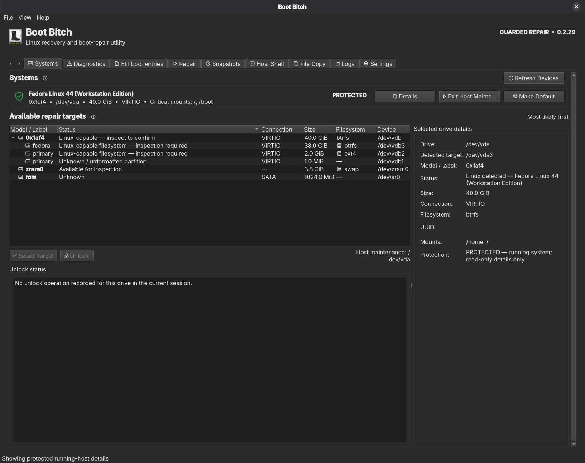
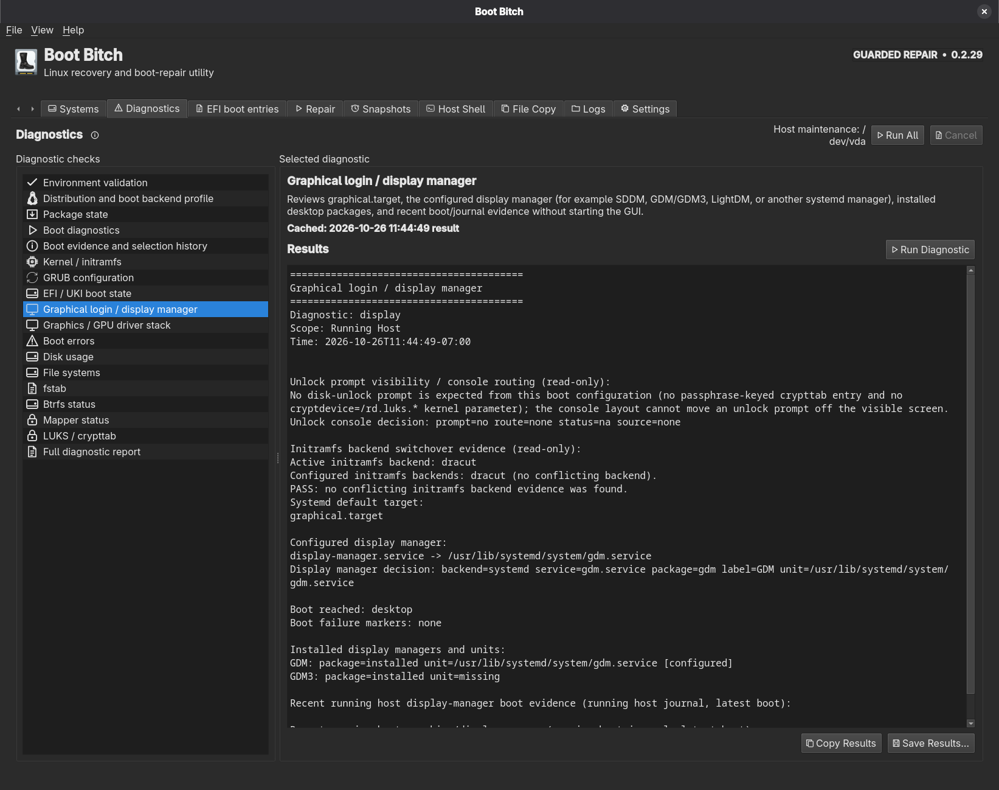
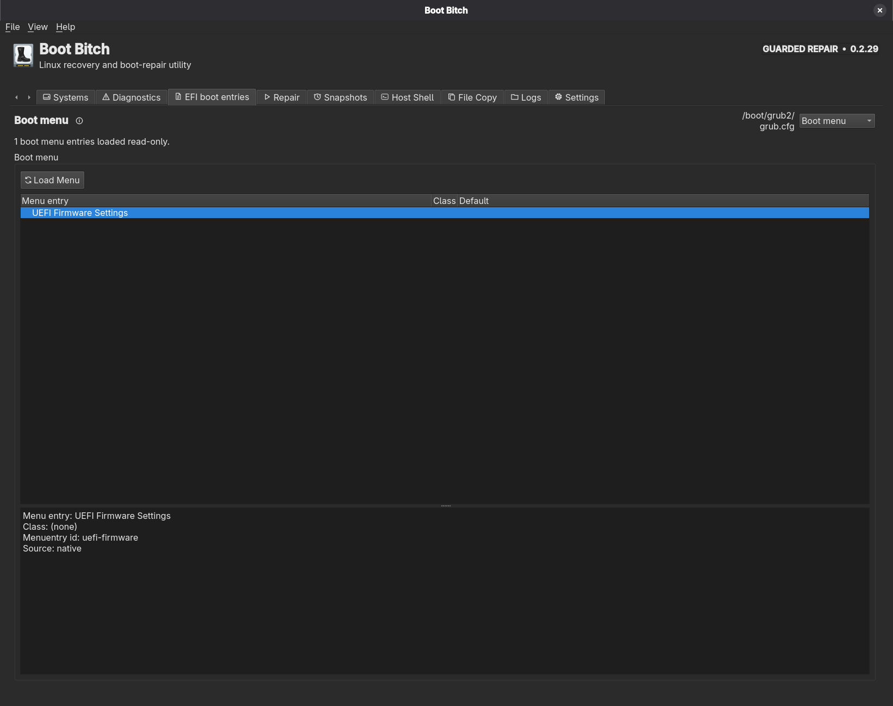
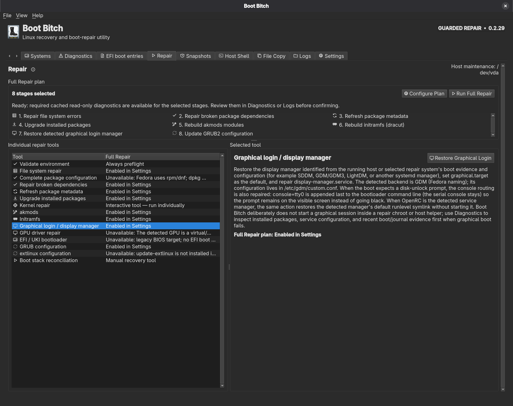
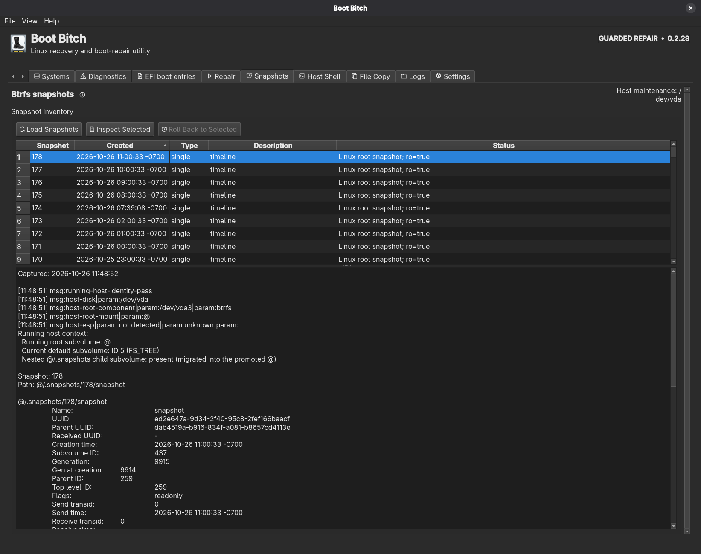
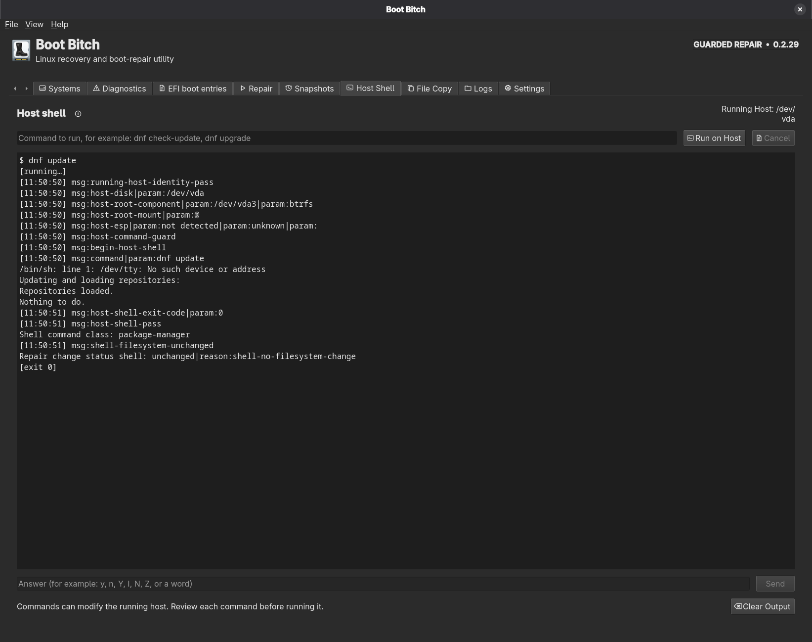
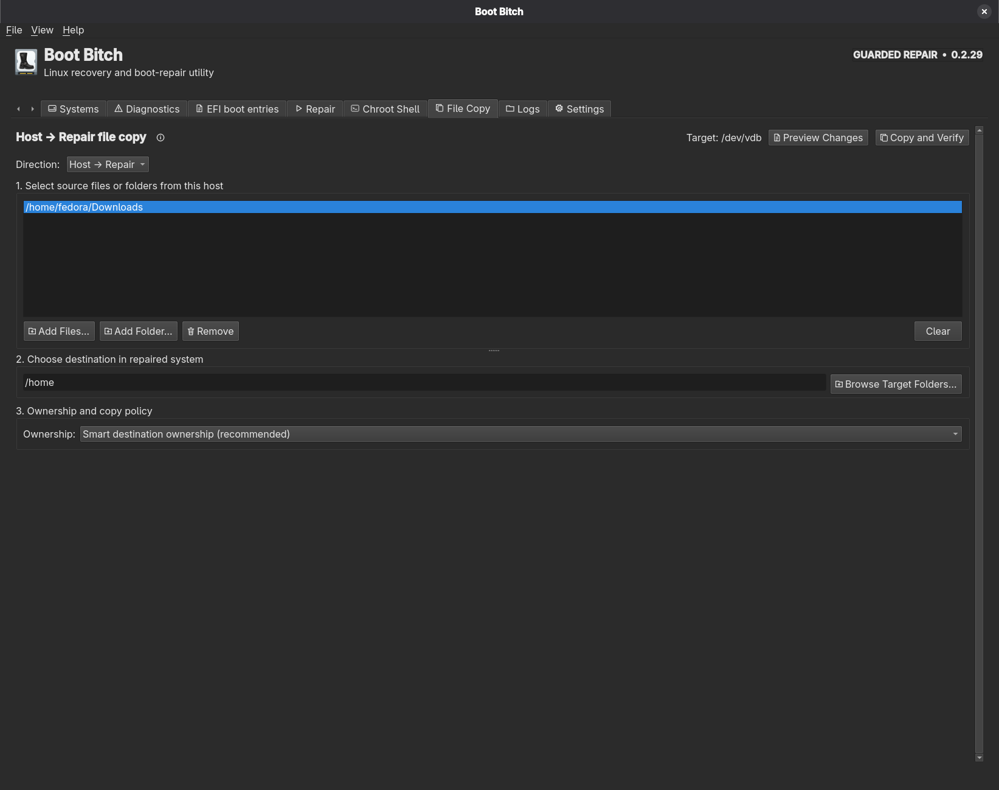
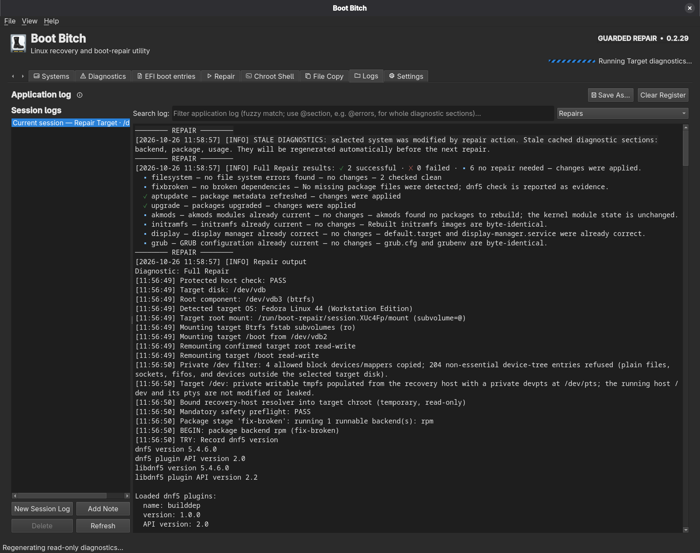
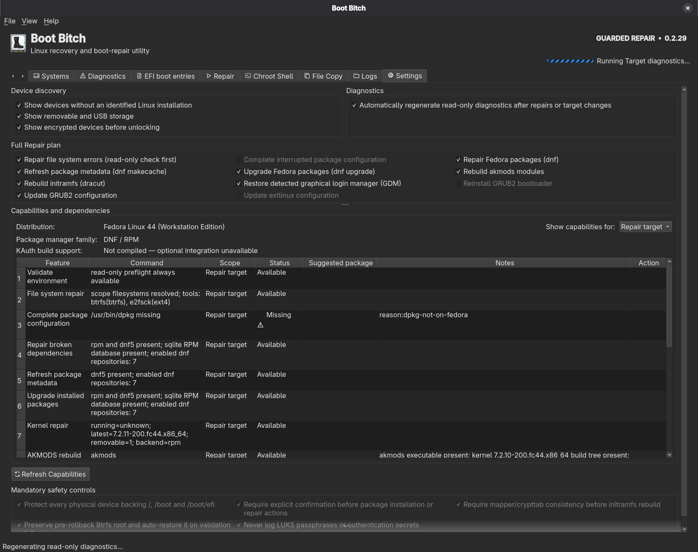

# Boot Bitch 0.2.30 — maintenance release

Boot Bitch is a native Qt 6 Linux recovery utility. The application command and Debian package retain the stable technical name `boot-repair` for compatibility; the source repository is `Boot_Bitch`. Version 0.2.30 includes the Host/Target repair-environment isolation hardening (target-scope dnf5/dracut identity pins, the fresh-procfs guarantee and the scope-labeled identity reads), the Snapshots tab visible whenever a snapshot inventory exists, in-run confirmations for package-mutating repair stages, graphical-login repair on every service manager including the black-screen-after-unlock class, the splitter and plan-frame layout alignment, cancel/cache/shell and session-log fixes in both editions, a security hardening pass over the backend and both GUIs, the EFI boot entries manager, the guarded diagnostics cache, simulation-first repair stack, Btrfs snapshot recovery, audited chroot shell, verified file copy, responsive Qt interface, the Debian Etch (Qt 3) legacy edition, and native RPM/APK artifacts with Alpine, Arch and Fedora repair backends. The snapshot support is now complete end to end: one guarded Install/Enable action creates the Snapper root configuration and the first snapshot, the transactional rollback accepts single, pre and post snapshots, the Snapshots tab gains a manual Create Snapshot action and an All/Single/Pre/Post filter, per-device firmware evidence carries versions, a clean repair's completion schedules exactly the affected diagnostic regeneration, and the diagnostics/repair cycle received a performance pass. Each repair layer performs the strongest practical read-only or trial preflight available, applies only recognized deterministic corrections, and stops on unknown failures instead of guessing. The application was written to address the lack of coherent tooling that lets a non-developer restore a system so it can boot after something goes wrong. Common boot issues can be addressed directly, while the diagnostics, chroot shell and file-copy tools cover deeper problems.

This project was written with LLM assistance under human guidance, requirements and manually verified tests.

**Developer:** CaptainMorgan12

## Supported systems

Boot Bitch must be launched from a **different booted Linux environment for ordinary repair-target work**: a Linux live USB, recovery stick, or another Linux installation on a different physical drive. The running host can also be selected explicitly as a guarded Host Maintenance target. The GUI needs a Qt 6.4+ desktop (the Debian Etch legacy edition runs on Etch's Qt 3 desktop). Repair backends are selected from read-only probe evidence, never from the distribution name:

- **Debian / Ubuntu / TUXEDO and derivatives** — APT/dpkg package repair, initramfs-tools, DKMS, GRUB, TUXEDO UKI and EFI/UKI recovery.
- **Arch-family** — sandboxed pacman transactions, mkinitcpio, conventional GRUB/EFI and systemd-boot/UKI layouts.
- **Fedora / RHEL and openSUSE / SUSE** (0.2.25) — guarded DNF5/RPM package transactions, dracut initramfs with `lsinitrd` verification, GRUB2 configuration and boot-code repair, and the systemd GDM display path.
- **Alpine** (0.2.25) — `apk fix`/`apk upgrade` transactions, mkinitfs initramfs, config-only extlinux regeneration, OpenRC display-manager restore and guarded UEFI GRUB repair.
- **Debian Etch (legacy)** (0.2.26) — the Qt 3 / KDE 3.5 edition with the same privileged helper: LUKS unlock, split-LVM targets, guarded menu.lst regeneration, file copy, host maintenance and Make Default.

Host Maintenance runs the supported stages natively on the active Debian/Ubuntu, Fedora, Arch, Alpine or Debian Etch (legacy) system. Host EFI/UKI repair remains Debian/Arch-only (Alpine EFI adds guarded GRUB EFI repair), and unknown boot layouts are refused instead of guessed.

## Install

Download the artifact for your system from the GitHub release page and verify it against the attached `SHA256SUMS`:

| System | Artifact | Install |
| --- | --- | --- |
| Debian/Ubuntu/TUXEDO | `boot-repair_0.2.30_amd64.deb` | `sudo apt install ./boot-repair_0.2.30_amd64.deb` |
| Debian Etch (legacy, Qt 3) | `boot-repair-legacy_0.2.30-etch1_amd64.deb` | `sudo dpkg -i ./boot-repair-legacy_0.2.30-etch1_amd64.deb` |
| Arch | `boot-repair-0.2.30-x86_64.pkg.tar.zst` | `sudo pacman -U boot-repair-0.2.30-x86_64.pkg.tar.zst` |
| Fedora/RHEL | `boot-repair-0.2.30.x86_64.rpm` | `sudo dnf install ./boot-repair-0.2.30.x86_64.rpm` |
| openSUSE/SUSE | `boot-repair-0.2.30.x86_64.rpm` | `sudo zypper install ./boot-repair-0.2.30.x86_64.rpm` |
| Alpine | `boot-repair-0.2.30.apk` | `sudo apk add --allow-untrusted ./boot-repair-0.2.30.apk` |
| Any Linux desktop | `boot-repair_0.2.30_x86_64.AppImage` | `chmod +x boot-repair_0.2.30_x86_64.AppImage && ./boot-repair_0.2.30_x86_64.AppImage` |

The native packages install the GUI, bundled icons, desktop metadata, the manual page, the EFI label helper and the privileged helper at `/usr/libexec/boot-repair/boot-repair-helper`. Privileged actions are authorized through Polkit/`pkexec` and use the host's runtime tools (`mount`, `cryptsetup`, `btrfs`, `efibootmgr`, and the selected distribution's boot and package tools); install the tools needed for the repair you intend to run.

Launch the installed command as `boot-repair`. On GNOME, install the optional `qt6-gtk-platformtheme` and `qt6-xdgdesktopportal-platformtheme` packages for GTK-like controls and native file dialogs; KDE uses its normal Qt platform theme. The AppImage uses the same privilege boundary and is intended for portable use, not as a replacement for the native package; its file dialogs use Qt's own implementation, while installed builds keep their desktop's native dialogs.

`./scripts/install.sh` detects the host package family and installs a locally built `.deb`, RPM, Arch package or APK after an explicit `INSTALL` confirmation. `./scripts/install.sh --source` installs a staged CMake build under `/usr/local` (or another absolute `PREFIX`), and `./scripts/uninstall.sh` removes a detected native package or the source install after an explicit `UNINSTALL` confirmation.

## Build from source

### Dependencies

Required:

- C++17 compiler (GCC or Clang)
- CMake 3.20+
- Ninja
- Qt 6.4+ Core/Gui/Widgets development files

Runtime support used by the guarded repairs:

- Polkit / `pkexec`; util-linux (`lsblk`, `findmnt`, `blkid`, mount tools)
- `rsync` and `cryptsetup` for verified file copy and LUKS unlock
- systemd `systemctl` for graphical-target and display-manager repair
- `efibootmgr` for guarded UEFI entry/order inspection
- binutils `objcopy` for TUXEDO UKI verification; Python 3 for guarded EFI label updates
- file system check tools (for example `e2fsprogs`, `dosfstools`, `btrfs-progs`, `xfsprogs`) for the read-only-first file system repair engine

`./scripts/setup-dev-deps.sh` installs the build/runtime set for the detected package manager (APT/dpkg, pacman, DNF/RPM, zypper/RPM or apk), and `./scripts/check-dev-env.sh` inspects the environment without installing anything. The Debian/Ubuntu/TUXEDO command is:

```bash
sudo apt update && sudo apt install --no-install-recommends -y \
    build-essential cmake ninja-build pkg-config \
    qt6-base-dev qt6-base-dev-tools extra-cmake-modules \
    pkexec util-linux mount rsync cryptsetup btrfs-progs systemd \
    efibootmgr binutils python3 lvm2 mdadm
```

### Building

The standard manual build for your own system:

```bash
cmake -S . -B build -G Ninja -DCMAKE_BUILD_TYPE=Release
cmake --build build -j"$(nproc)"
./build/boot-repair
```

A source install uses `-DCMAKE_INSTALL_PREFIX=/usr/local` (or another prefix) followed by `sudo cmake --install build`.

`./scripts/build.sh` performs the same Release build plus the Debian-family `.deb` and AppImage in one command, and the per-distribution package scripts (`package-deb.sh`, `package-legacy.sh`, `package-arch.sh`, `package-rpm.sh`, `package-alpine.sh`) each build one native package for the matching system without installing it; each script needs its distribution's own packaging tools (`dpkg-dev`, `rpmbuild`, `makepkg`, `abuild`). Nothing is installed on your system unless you run `install.sh`.

## Safety model

- Boot Bitch runs as the normal desktop user. Privileged work is isolated in a whitelisted helper behind Polkit/`pkexec`; one authorization per scope is reused until the session is locked or the application exits.
- Ordinary repair-target actions refuse the running host. The top-level devices backing `/`, `/boot` and `/boot/efi` stay protected, and Host Maintenance must be selected explicitly, repeating host identity and mount checks.
- Every repair layer runs the strongest practical read-only or simulation preflight first and applies only recognized deterministic corrections; unknown failures stop the stage instead of guessing.
- Every modifying operation requires an explicit GUI confirmation, and diagnostics are cached per scope and invalidated by writes.
- LUKS passphrases are sent to the helper over standard input only, never in command arguments or logs.
- File copy uses `rsync -aHAX --numeric-ids` without `--delete`, validates containment and ownership, and verifies the result.
- Btrfs rollback keeps the source snapshot unchanged, preserves the previous root as `@rollback-before-*`, and restores it automatically when critical post-switch validation fails.
- Missing optional runtime tools disable only the related feature; host tools are never installed silently.
- The AppImage self-update channel is transport-authenticated over HTTPS but not content-signed; verify the release `SHA256SUMS` before applying a fetched update.

Still intentionally constrained in 0.2.30:

- automatic/implicit EFI-loader reinstall: EFI repair remains an explicit action or opt-in Full Repair stage;
- transactional rollback is limited to Btrfs layouts whose installed root is a detectable top-level root subvolume (`@` or the name-agnostic detection) with Snapper-style root snapshots; single, pre and post snapshots are accepted rollback targets. Running-host rollback additionally requires a Snapper root configuration, no `subvolid=` pin, no separate `/boot` and no other nested `@` child subvolumes, and only migrates a nested `@/.snapshots` child subvolume; unsupported layouts are refused rather than guessed. The manual Create Snapshot action requires the same Snapper root configuration and `.snapshots` store;
- unsupported package-manager operations on Arch (such as standalone APT/dpkg stages), unknown boot layouts, and package transactions whose preflight reports repository errors, removals or unresolved dependencies; these remain hard-gated.

## Using Boot Bitch

- **Systems** — shows the protected running host separately from ranked repair drives; select a physical target (and unlock LUKS when needed) before any repair work.
- **Diagnostics** — read-only reports for the Running Host or the selected repair drive, including boot state, firmware entries and file systems.
- **EFI boot entries** — the UEFI firmware entry list with reorder, rename and delete (BootCurrent is protected, NVRAM writes are verified and rolled back), plus a read-only boot-menu tree.
- **Repair** — the configurable Full Repair plan and individual tools (file system repair, package configuration, broken dependencies, metadata refresh, adaptive package upgrade, DKMS, display manager, initramfs, EFI/UKI and GRUB), or Host Maintenance on the active system.
- **Snapshots** — read-only Btrfs/Snapper inventory with an All/Single/Pre/Post filter, a guarded manual **Create Snapshot** action, and the transactional rollback workflow (single, pre and post targets), including running-host rollback with a persistent **Reboot required** reminder.
- **Chroot Shell** — one confirmed root command at a time inside the selected repair system. When a command asks a question (apt/dnf/dpkg prompts), it appears in a popup and your answer is sent back to the command; cancel stops it. Non-interactive flags such as `-y`/`--noconfirm` remain recommended for unattended runs.
- **File Copy** — guarded Host → Repair and Repair → Host transfers with preview and verification; repair-to-host copies remove setuid/setgid bits and file capabilities and refuse shared scratch (sticky or world-writable) destination directories.
- **Logs / Settings** — per-session logs with section filters, and the repair plan, safety rules and capability report.

## Screenshots

These anonymized screenshots show Boot Bitch running in a disposable recovery VM. The target is a separate virtual disk; personal host paths and physical-device identifiers have been removed. The captures were refreshed for this release — nine screenshots (`1.png`..`9.png`) in the order below.

### Systems



### Diagnostics



### EFI boot entries



### Repair



### Snapshots



### Host Shell



### File Copy



### Logs



### Settings



## 0.2.30 refinements

The changes in this release are listed below. See the [0.2.30 release notes](docs/release-notes-0.2.30.md).

- Input-device and network repair walk a ranked driver-fallback ladder through the delta menus, honoring the live-keyboard rule; the no-adapter classifier, the boot-log fallback and per-device firmware evidence with versions keep the verdicts honest. The Boot capabilities table isolates the selected scope, shows Installed/Available/Missing, and fills the Packages cells from a shared per-distribution table plus probes.
- A module-build stage with an empty DKMS/akms/akmods state proves nothing to build and reports unchanged without a package-change confirmation. Kernel evidence names why a repository kernel is not installable, including the gcc-16-for-host blocker class, and the diagnostics are faster: a cached kernel inventory, a re-snapshotted broker, bounded initramfs readers and a re-executing broker cut the preamble stalls.
- Snapshot management is complete: one guarded action installs the missing packages, creates the Snapper root configuration and the first snapshot; the transactional rollback accepts single, pre and post snapshots on any detected root name, captures a separate /boot, optionally rolls a target /home back with the root, keeps the in-window confirmation and automatic restore, and re-rolls the chained replacement.
- Completion-side regeneration and reliability: a clean repair schedules the affected diagnostic regeneration, File Copy verifies checksums, helper-owned mounts are released before session cleanup, and the Fedora stall and menu-answer bound are fixed; declined or cancelled snapshot outcomes stay honest, and the input include re-verify closes on the fresh inclusion evidence and the honest Etch-era rebuild proof.
- The Debian Etch legacy edition keeps full parity: interactive input and network repairs, the read-only EFI boot-entries and boot-menu views, the shared capability-packages table, the live-keyboard fallback, translated interface catalogs, the same confirm and cancel behavior, and a complete popup floor and content-hug contract; the secret-file NUL class, the tab gate and the settings-persistence fixes landed in both editions.
- Every standard dialog follows one measured popup contract — fixed historical openings, a 470-pixel drag floor, no maximum width, the content hug with the settled re-fit — and the File Copy and Logs rows reflow responsively at the narrowest width while Cancel stays available during interactive menus. Localization ships exactly the 23 supported catalogs, and the artifacts are validated across the Debian, AppImage, Arch, RPM, APK and Etch packages.

## Earlier releases

The per-version change summaries for 0.2.29 and earlier are recorded in [CHANGELOG.md](CHANGELOG.md) and in each GitHub release's own notes. Versions before 0.2.15 were development iterations that were not published as GitHub releases.


## License

Boot Bitch is released under the MIT License. See `LICENSE`.

Boot Bitch comes with ABSOLUTELY NO WARRANTY, to the extent permitted by applicable law.


